# CMSC 672 Computer Vision: Exam Study Guide

[Read the fully rendered guide](CMSC_672_Exam_Study_Guide.html)

## How to study with this guide

For each topic, practice four things: **explain the idea, draw the geometry or pipeline, calculate a small example, and state the assumptions or failure cases.** Lecture 1 emphasizes conceptual understanding and drawing; the quizzes also ask for calculations and algorithm order.

1. Start with the review-board checklist below and mark your weak areas.
2. Work through the lecture sections with paper and pencil. Hide worked answers until you try the problem.
3. Use the formula sheet to check recall, then complete the self-test near the end.
4. Revisit the linked slides for visual examples. Page references are **PDF page numbers**, counting the first page as 1.

### Navigation

- [Review-board priorities](#review-board-priorities)
- [Notation and mathematical tools](#notation-and-mathematical-tools)
- [Lectures 1–2: vision and image formation](#lecture-1-introduction-to-computer-vision)
- [Lectures 3–4: filtering and frequency](#lecture-3-image-filtering-i)
- [Lectures 5–6: features and matching](#lecture-5-image-features-i-harris-corners)
- [Lectures 7–11: learning, CNNs, detection](#lecture-7-machine-learning-for-computer-vision)
- [Lectures 12–14: transformations and cameras](#lecture-12-image-transformations)
- [Lectures 15–17: multiple views and motion](#lecture-15-triangulation-and-epipolar-geometry)
- [Lecture 18: image synthesis](#lecture-18-image-synthesis)
- [Formula sheet](#formula-sheet)
- [Quiz review](#quiz-review-explanations-for-quizzes-15)
- [Self-test](#self-test-try-before-reading-the-answers)
- [Study sequence and readiness checklist](#study-sequence-and-readiness-checklist)

## Review-board priorities

These are priorities supported by the photos, not predictions of exam weighting.

| Review area | Lectures | Be able to do |
|---|---|---|
| Image formation | 1–2 | Define CV and an image; draw pinhole rays; use the thin-lens equation; distinguish depth of field and field of view; explain RGB and the Bayer pattern. |
| Image filtering | 3–4 | Compare point and neighborhood operations; perform filtering; explain Gaussian blur, gradients, sharpening, thresholding, Fourier magnitude/phase, convolution theorem, low/high-pass filters, and Gaussian/Laplacian pyramids. |
| Image features | 5–6 | Derive the Harris approximation; interpret eigenvalues; explain scale selection, SIFT, descriptor matching, the ratio test, ROC, precision, and recall. |
| ML for CV | 7–11 | Explain generalization, regression/classification, loss, perceptrons, backpropagation, learning rate, CNN sizes and parameters, pooling, detector families, and detection evaluation. |
| Single-camera geometry | 12–14 | Write and compose transformations; use homogeneous coordinates; estimate affine transforms and homographies; explain RANSAC, stitching, camera projection, calibration, intrinsics, and extrinsics. |
| Multi-camera geometry | 15–17 | Triangulate; distinguish essential/fundamental matrices; explain the eight-point algorithm, rectification, disparity/depth, SfM, and optical flow. |
| Additional stated coverage | 18 and companion 18a | Compare AE, VAE, GAN, autoregressive, and diffusion models; explain how synthesis is conditioned on text. |

The board highlights **depth estimation** and **optical flow** with boxes. The ML photo specifically calls out **stride, kernel size, and padding**. Practice these explicitly.

## Notation and mathematical tools

| Symbol | Meaning in this guide |
|---|---|
| I(x,y) | Image intensity at a pixel; color images have multiple channels. |
| $I_x,I_y,I_t$ | Spatial and temporal intensity derivatives. |
| $G_\sigma$ | Gaussian kernel with standard deviation $\sigma$. |
| $\mathbf{x}=(u,v,1)^T$ | Homogeneous image point in pixel coordinates. |
| $\hat{\mathbf{x}}=K^{-1}\mathbf{x}$ | Image point expressed in normalized camera coordinates. |
| $\mathbf{X}=(X,Y,Z,1)^T$ | Homogeneous 3D point. |
| H | 3 × 3 homography; also image height when discussing tensor sizes. Context matters. |
| P | 3 × 4 camera projection matrix. |
| K,R,t,C | Intrinsics, rotation, translation, and camera center. |
| E,F | Essential and fundamental matrices. |
| ∼ | Equal up to a nonzero scale factor. |

**Three recurring mathematical ideas:**

- **Taylor approximation:** replace a function after a small displacement by its value plus its first derivatives. This connects Harris corners to optical flow.
- **Least squares:** solve $A\theta\approx b$ by minimizing $\Vert A\theta-b\Vert ^2$. If A has full column rank, the formal solution is $(A^TA)^{-1}A^Tb$; QR/SVD solvers avoid explicitly forming this inverse.
- **Homogeneous least squares:** solve $A\theta\approx0$ subject to $\Vert \theta\Vert =1$. If $A=U\Sigma V^T$, choose the last column of V from a full SVD, associated with the smallest singular value/nullspace. The norm constraint excludes the trivial zero solution. Homographies, cameras, triangulation, and the eight-point algorithm all use this pattern.

For a symmetric matrix M, eigenvectors identify principal directions and eigenvalues identify variation along them. A large Harris eigenvalue means a large intensity change for shifts in that direction; it does not mean the corner itself has a large spatial extent.

## Lecture 1: Introduction to computer vision

**Source:** [Lecture 1](Slides/01_intro.pdf), especially pp. 7–27, 39–48, 79–80.

Computer vision develops computational representations and methods to understand and interact with the visual world. Tasks range from filtering pixels to recognizing objects, inferring geometry, understanding motion, and describing scenes.

An image is a measurement, not a complete description of reality. Projecting a 3D scene onto a 2D sensor loses depth. Different scenes can produce similar pixels; the same object can produce very different pixels under changes in lighting, pose, scale, viewpoint, occlusion, or background.

| Task | Typical output |
|---|---|
| Classification | One or more image-level labels. |
| Detection | Object classes and bounding boxes. |
| Semantic segmentation | A class label for each pixel. |
| Instance segmentation | A separate pixel mask for each object instance. |
| Reconstruction | 3D structure and/or camera parameters. |
| Motion estimation | Correspondences or displacement vectors between frames. |
| Synthesis | A new image, optionally conditioned on another input. |

**Explain aloud:** Why can low training error fail to imply visual understanding? A model can exploit a background correlation or a narrow training distribution that fails on new scenes.

**Draw:** A pipeline from scene → light and camera → pixels → filters/features → recognition or reconstruction. Be able to explain where information is lost and where assumptions enter.

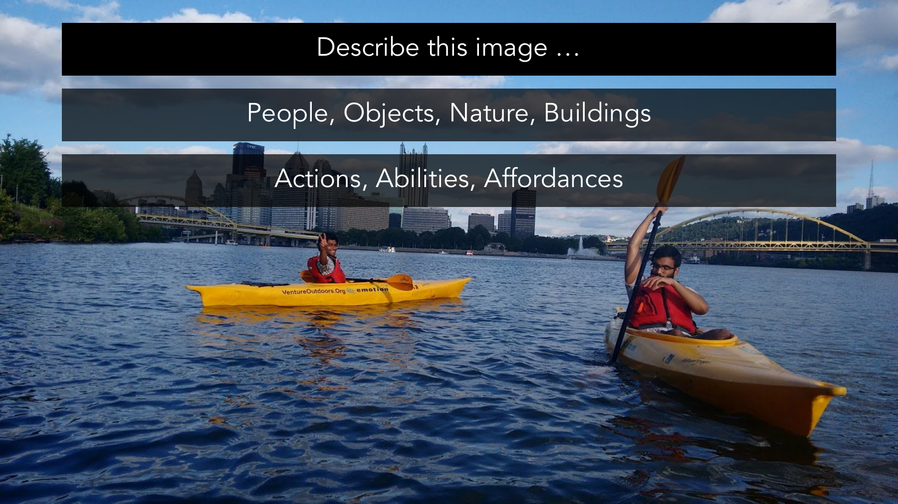

*[Lecture 1, PDF p. 13](Slides/01_intro.pdf) — Scene understanding involves objects, actions, and affordances.*

## Lecture 2: Image formation and acquisition

**Source:** [Lecture 2](Slides/02_image-formation.pdf), pinhole/lenses pp. 2–48; color and sensors pp. 55–71.

### Pinhole geometry

Light travels from a scene point through a small aperture to an image plane. Similar triangles relate projected position to depth. Using a **virtual image plane in front of the camera**:

$$
u=\frac{fX}{Z},\qquad v=\frac{fY}{Z}.
$$

Here, **u and v** are the horizontal and vertical positions in the image. **X and Y** locate the scene point relative to the camera, **Z** is its depth, and **f** is the focal length. Divide each scene coordinate by depth, then multiply by focal length to obtain its projected image coordinate.

On the physical image plane behind the pinhole, the image is inverted and the coordinates acquire a minus sign under the corresponding convention. State which drawing you use.

- Larger depth Z → smaller projected size.
- Larger focal distance f → larger projected size for the same scene and sensor.
- A large pinhole mixes rays and increases geometric blur.
- A smaller pinhole reduces geometric blur but admits less light; an extremely small aperture also suffers diffraction.

**Example:** With f = 10 mm, an object point at X = 100 mm and Z = 1000 mm projects to u = 1 mm on the virtual plane. Doubling depth halves u.

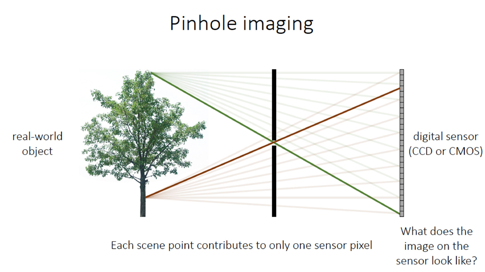

*[Lecture 2, PDF p. 10](Slides/02_image-formation.pdf) — Pinhole ray geometry and the inverted image.*

### Thin lenses and focus

A lens gathers more light while bringing rays from a focused object point together on the sensor. For a real object and real image under the positive-distance convention:

$$
\frac{1}{f}=\frac{1}{s_o}+\frac{1}{s_i},\qquad s_i=\frac{fs_o}{s_o-f}.
$$

Here $s_o$ is object-to-lens distance and $s_i$ is image-to-lens distance. Signed magnification is $m=-\frac{s_i}{s_o}$; the minus sign represents inversion. As $s_o\to\infty$, $s_i\to f$.

**Worked example:** f = 50 mm, $s_o=1000$ mm:

$$
s_i=\frac{50(1000)}{1000-50}\approx52.63\text{ mm},\qquad |m|\approx0.0526.
$$

To derive the lens relationship, draw the central ray that passes through the lens center and the ray parallel to the optical axis that passes through the focal point. Use similar triangles to relate the two image-height expressions.

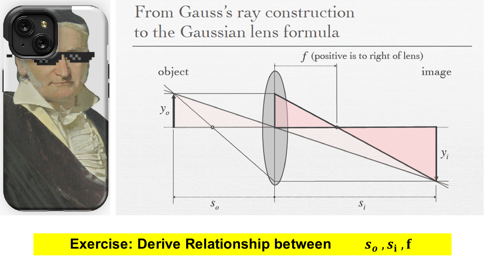

*[Lecture 2, PDF p. 43](Slides/02_image-formation.pdf) — Thin-lens geometry: relate focal length, object distance, and image distance.*

### Depth of field versus field of view

| Concept | Definition | Main relationship to remember |
|---|---|---|
| Depth of field, DoF | Range of object depths that are acceptably sharp for a focus setting. | Smaller aperture → greater DoF, other conditions held fixed. |
| Field of view, FoV | Angular extent of the scene captured. | Shorter focal length → wider FoV for a fixed sensor. |

For sensor width w, horizontal FoV is approximately $2\arctan(w/(2f))$. A lens can have a wide FoV while still having shallow DoF. The heading on Lecture 2 p. 48 concerns FoV; do not confuse the slide's “DoF” text there with the field-of-view relationship.

### Color, sampling, and the Bayer pattern

- Color sensation depends on the spectrum of light and the responses of three cone types. RGB is a three-component representation, not a complete wavelength spectrum.
- A grayscale image is a 2D array; an RGB image has three channels. Common layouts are $H\times W\times3$ and $3\times H\times W$.
- An 8-bit channel has 256 possible integer values, 0–255. Three channels use 24 bits per uncompressed pixel, before file-format overhead.
- A standard Bayer color filter array has **50% green, 25% red, 25% blue** sensor sites. A site initially measures one filtered channel, not all three.
- **Demosaicing** estimates missing channels using neighboring measurements; nearest-neighbor and bilinear interpolation are simple methods.

**Check:** A 100 × 100 RGB image with 8 bits per channel needs 100(100)(3) = 30,000 bytes for raw pixel values. A one-bit binary mask of the same size needs 1,250 bytes when packed.

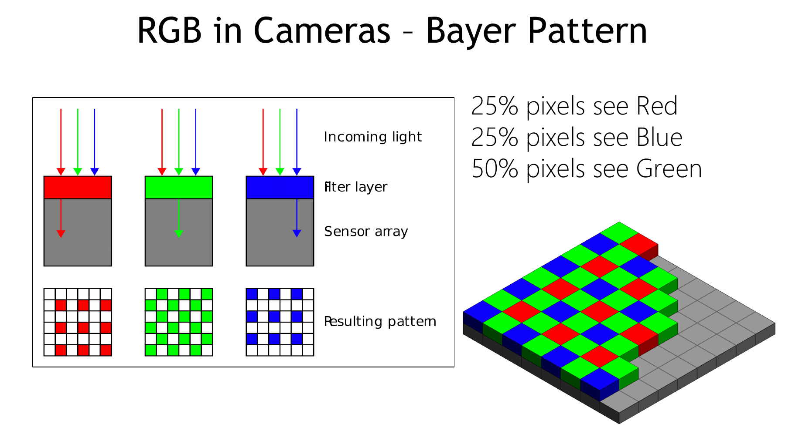

*[Lecture 2, PDF p. 68](Slides/02_image-formation.pdf) — Bayer sampling: half the sensor sites measure green.*

## Lecture 3: Image filtering I

**Source:** [Lecture 3](Slides/03_image-filtering-i.pdf), filtering pp. 22–95; edges/sharpening/thresholding pp. 96–123.

### Point operations versus neighborhood operations

A point operation changes a pixel using its own value, such as brightness adjustment or thresholding. A neighborhood operation uses nearby pixels, such as blur or edge detection. Warping, introduced later, changes where image values are sampled.

For a kernel k, discrete convolution is

$$
(I*k)(x,y)=\sum_i\sum_j k(i,j)I(x-i,y-j).
$$

Correlation uses I(x+i,y+j) instead. Convolution flips the kernel in both spatial axes. Symmetric Gaussian/box kernels give the same result under either operation; an asymmetric derivative kernel can change response sign. Many CNN implementations use correlation while calling it convolution.

**By hand:** identify padding, stride, kernel orientation, and whether the question uses convolution or correlation. Multiply corresponding patch/kernel entries, sum them, move the kernel, repeat. The patch and kernel are not multiplied as ordinary matrices.

### Kernels to recognize

$$
\mathrm{Box\ blur:}\quad\frac{1}{9}\begin{bmatrix}1&1&1\\1&1&1\\1&1&1\end{bmatrix}
\mathrm{Gaussian:}\quad\frac{1}{16}\begin{bmatrix}1&2&1\\2&4&2\\1&2&1\end{bmatrix}
\mathrm{Vertical\ edges:}\quad\begin{bmatrix}-1&0&1\\-1&0&1\\-1&0&1\end{bmatrix}
\mathrm{Horizontal\ edges:}\quad\begin{bmatrix}-1&-1&-1\\0&0&0\\1&1&1\end{bmatrix}
\mathrm{Sobel}\ x:\quad\begin{bmatrix}-1&0&1\\-2&0&2\\-1&0&1\end{bmatrix}
\mathrm{Sobel}\ y:\quad\begin{bmatrix}-1&-2&-1\\0&0&0\\1&2&1\end{bmatrix}
$$

An x derivative responds to intensity changes across the horizontal direction, so it detects **vertical edges**. An edge's tangent direction is perpendicular to the gradient.

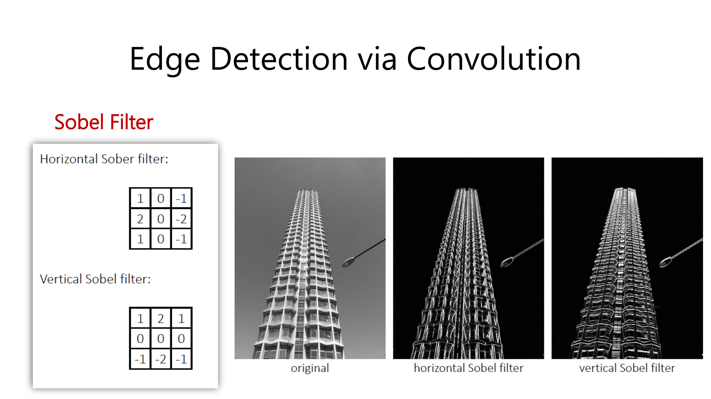

*[Lecture 3, PDF p. 116](Slides/03_image-filtering-i.pdf) — Derivative filters detect changes in intensity.*

The slide names filters by derivative direction. A horizontal intensity derivative responds to vertical edges, and vice versa.

### Gaussian smoothing

$$
G_\sigma(x,y)=\frac{1}{2\pi\sigma^2}\exp\left(-\frac{x^2+y^2}{2\sigma^2}\right).
$$

Nearby pixels receive larger weights. Increasing $\sigma$ increases blur and removes more fine detail. Truncated discrete kernels should be normalized to sum to 1 to preserve constant intensity away from boundaries. A Gaussian is separable into horizontal and vertical 1D filters.

**Worked patch:** For

$$
\begin{bmatrix}0&0&0\\0&90&0\\0&0&0\end{bmatrix}
$$

the box-filter output at the center is 10. The Gaussian approximation above gives $4(90)/16=22.5$, because it gives more weight to the center.

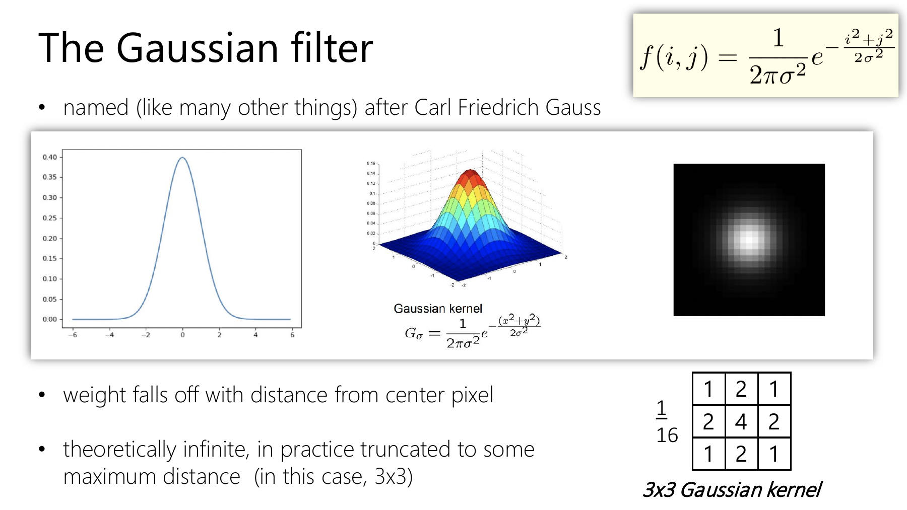

*[Lecture 3, PDF p. 89](Slides/03_image-filtering-i.pdf) — Gaussian filter weights emphasize nearby pixels.*

### Gradients, sharpening, and thresholding

$$
\nabla I=(I_x,I_y)^T,\qquad |\nabla I|=\sqrt{I_x^2+I_y^2},\qquad \theta=\mathrm{atan2}(I_y,I_x).
$$

Finite differences approximate derivatives. Derivatives also amplify noise, so smoothing before differentiation often improves edge detection. At $I_x=3,I_y=4$, gradient magnitude is 5 and direction is about 53.1° from the positive x axis.

Unsharp masking isolates detail and adds it back:

$$
D=I-G_\sigma*I,\qquad I_{\mathrm{sharp}}=I+\alpha D.
$$

Thresholding produces a mask, for example B(x,y) = 1 when $I(x,y)>T$, otherwise 0. It discards intensity detail. It can reduce storage when the output is actually stored as packed binary values.

**Common mistakes:** forgetting blur normalization; claiming derivatives detect changes along the edge; confusing smoothing with sharpening; ignoring boundary padding.

## Lecture 4: Image filtering II and the Fourier domain

**Source:** [Lecture 4](Slides/04_image-filtering-ii.pdf), Fourier pp. 3–40; filtering pp. 41–56; pyramids/blending pp. 57–75.

### What the Fourier transform represents

An image is expressed as a combination of sinusoidal patterns at different frequencies, orientations, amplitudes, and phases. The 2D DFT of an $M\times N$ image can be written

$$
F(u,v)=\sum_{x=0}^{M-1}\sum_{y=0}^{N-1}I(x,y)e^{-2\pi i(ux/M+vy/N)}.
$$

Write $F=\vert F\vert e^{i\phi}$. **Magnitude** describes the strength of each frequency component; **phase** describes its alignment and is crucial to spatial structure. Both are required for exact reconstruction.

In a centered spectrum (fftshift):

- The center is zero frequency/DC, representing the image sum under the unnormalized forward DFT; divided by the pixel count, it is the mean.
- Locations farther from the center represent higher frequencies.
- Broad smooth regions vary slowly; fine textures and sharp changes contain high frequencies.
- A sinusoidal stripe pattern produces paired frequency peaks. The frequency vector is perpendicular to the stripe direction.
- A spatial translation changes phase but preserves Fourier magnitude in the ideal periodic/continuous setting. Scaling and rotation change the frequency arrangement.

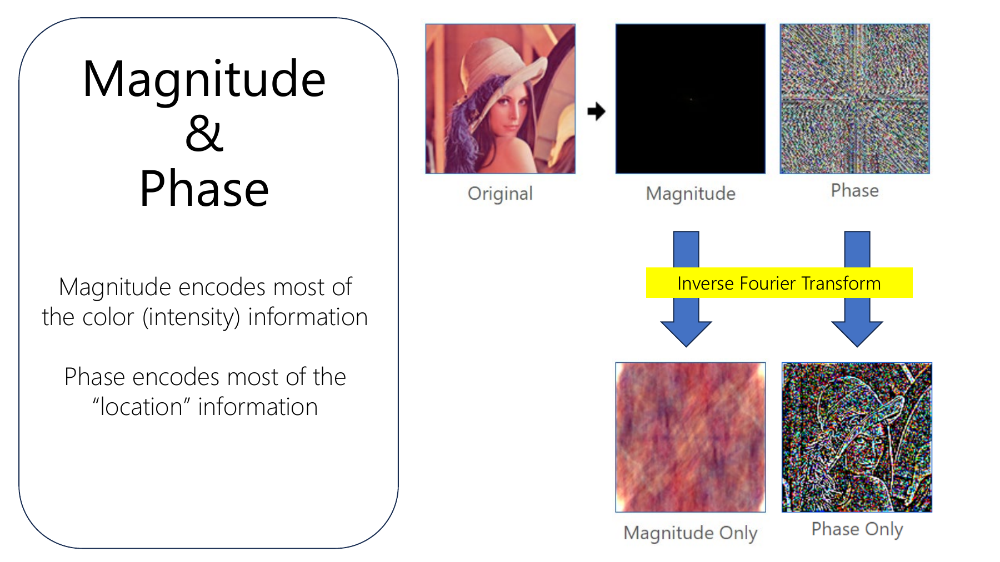

*[Lecture 4, PDF p. 31](Slides/04_image-filtering-ii.pdf) — Fourier magnitude and phase describe different parts of an image representation.*

### Convolution theorem and frequency filtering

$$
\mathcal{F}\{I*k\}=\mathcal{F}\{I\}\mathcal{F}\{k\}.
$$

Multiply spectra point by point, then inverse transform. A DFT implements circular convolution unless padding is used to obtain the intended linear convolution.

| Filter | Centered frequency-domain appearance | Effect |
|---|---|---|
| Low-pass | Pass region around the center; suppress exterior. | Smooth/blur; remove fine detail. |
| High-pass | Suppress center; pass outer frequencies. | Extract detail/edges; suppress slowly varying intensity. |
| Band-pass | Pass a range of distances from the center. | Retain selected scales of detail. |

**Draw:** An ideal low-pass mask is a white/pass disk centered at zero frequency with black/zero outside. A Gaussian low-pass mask fades smoothly rather than having a sharp cutoff. An ideal sharp cutoff can cause ringing in the spatial domain.

### Three meanings that must be kept distinct

1. **Laplacian derivative:** $\nabla^2 I=I_{xx}+I_{yy}$, a second-derivative operator. A smoothed version is $(\nabla^2G_\sigma)*I$.
2. **High-frequency residual used in this lecture:** $I-G_\sigma*I$, original minus blurred image. This is the expression to recognize for the quiz prompt that gives only an image and a Gaussian blur kernel.
3. **Laplacian pyramid band:** $L_k=G_k-\mathrm{Expand}(G_{k+1})$, subtracting the expanded next Gaussian level.

They are related ways to expose detail but are not identical formulas. Follow the construction specified in the question.

### Gaussian and Laplacian pyramids

**Gaussian pyramid:** blur, then downsample at each level. Blurring first reduces aliasing; blurring after subsampling cannot undo aliasing already introduced.

$$
G_0=I,\qquad G_{k+1}=\mathrm{Downsample}(G_\sigma*G_k).
$$

**Laplacian pyramid:** store a band of detail at each scale and keep the coarsest Gaussian image.

$$
L_k=G_k-\mathrm{Expand}(G_{k+1}),\qquad G_k=L_k+\mathrm{Expand}(G_{k+1}).
$$

Expansion includes upsampling and the appropriate interpolation filter, not merely inserting zeros. Reconstruction works by expanding the coarse image and adding the stored residuals.

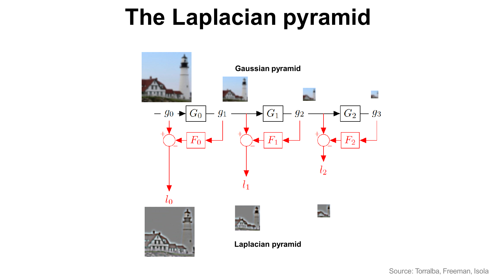

*[Lecture 4, PDF p. 64](Slides/04_image-filtering-ii.pdf) — Gaussian pyramid levels and Laplacian detail bands.*

**Multiscale blending:** build Laplacian pyramids of images A,B and a Gaussian pyramid of mask M; combine each level as $L_k=M_kL^A_k+(1-M_k)L^B_k$; reconstruct. Smooth masks at coarse scales blend broad illumination, while finer bands retain detail. This reduces the visible seam of a hard cut.

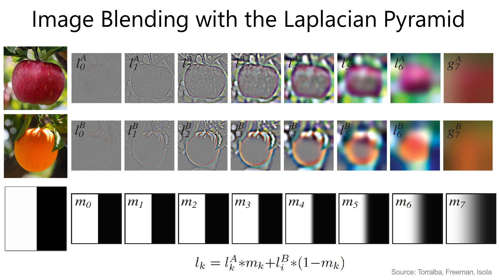

*[Lecture 4, PDF p. 73](Slides/04_image-filtering-ii.pdf) — Combine image bands using masks at matching scales.*

## Lecture 5: Image features I: Harris corners

**Source:** [Lecture 5](Slides/05_image-features-i.pdf), motivations pp. 2–13; Harris derivation and selection pp. 14–69.

### Why features?

Local features support stitching, correspondence, recognition, tracking, and reconstruction. A useful feature is repeatable across views, distinctive enough to match, localized accurately, and robust to relevant transformations.

The pipeline is **detect → describe → match**. A detector locates a point; a descriptor summarizes its neighborhood; a matcher compares descriptors. These are different operations.

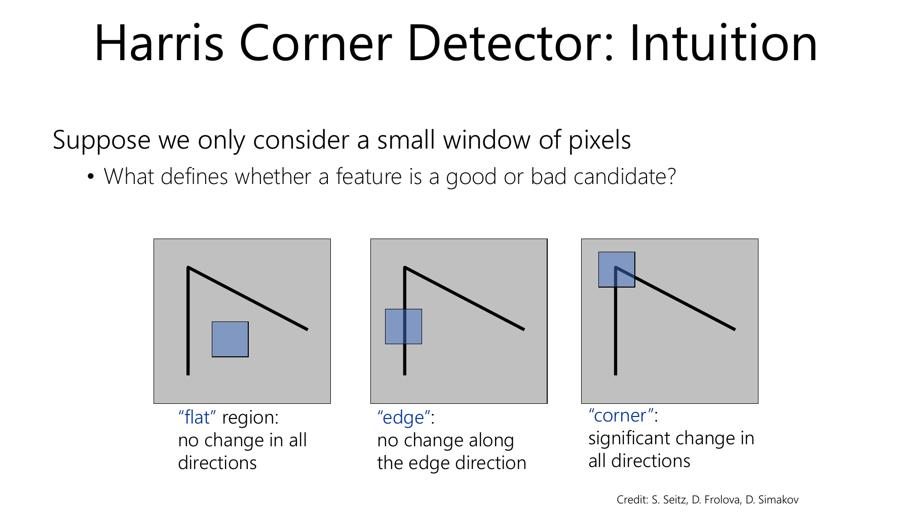

*[Lecture 5, PDF p. 15](Slides/05_image-features-i.pdf) — A corner changes significantly under shifts in every direction.*

### Derive the Harris approximation

Compare a window to itself after a small shift (u,v):

$$
E(u,v)=\sum_{x,y}w(x,y)[I(x+u,y+v)-I(x,y)]^2.
$$

For small shifts, $I(x+u,y+v)\approx I(x,y)+I_xu+I_yv$. Therefore

$$
E(u,v)\approx\sum w(I_xu+I_yv)^2
=\begin{bmatrix}u&v\end{bmatrix}M\begin{bmatrix}u\\v\end{bmatrix},
$$

$$
M=\sum w\begin{bmatrix}I_x^2&I_xI_y\\I_xI_y&I_y^2\end{bmatrix}.
$$

M is the second-moment/structure matrix. Do not substitute the image Hessian of second derivatives for it.

| Eigenvalues of M | Patch | Interpretation |
|---|---|---|
| Both small | Flat | Shifting in any direction changes little. |
| One large, one small | Edge | Shifting along the edge changes little. |
| Both large | Corner | Shifting in any direction changes substantially. |

For level sets E = 1, the ellipse's principal semi-axis lengths are proportional to $1/\sqrt{\lambda_i}$. A narrow error bowl means high sensitivity to displacement.

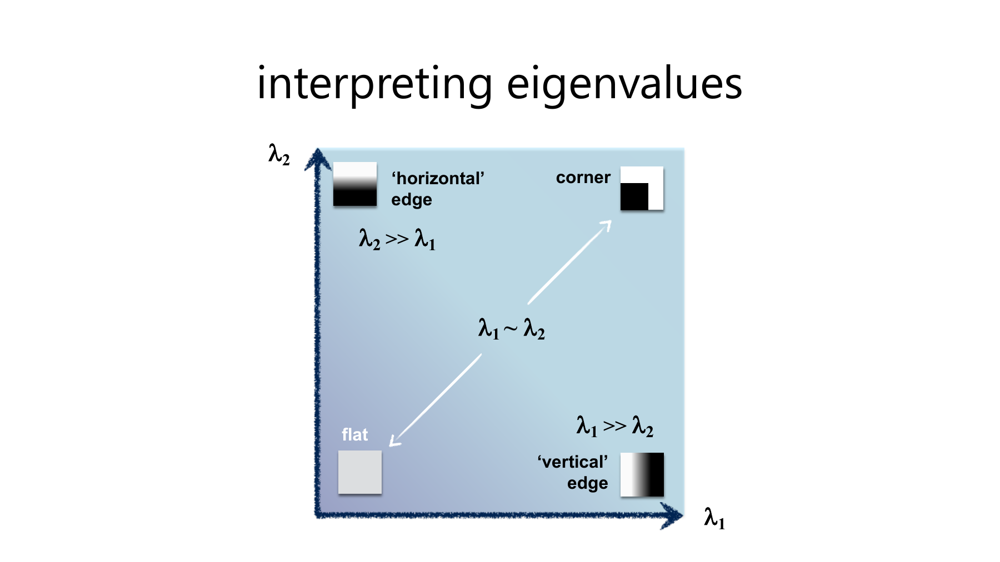

*[Lecture 5, PDF p. 55](Slides/05_image-features-i.pdf) — Harris eigenvalues distinguish flat patches, edges, and corners.*

### Detection recipe

1. Compute $I_x,I_y$.
2. Form $I_x^2,I_xI_y,I_y^2$.
3. Smooth/sum these products over a local window to form M at each pixel.
4. Require both eigenvalues to be sufficiently large, or use a corner score such as $R=\det(M)-k\mathrm{tr}(M)^2$.
5. Threshold and perform spatial non-maximum suppression to keep isolated response peaks.

The photos and slides emphasize eigenvalue thresholding. The determinant/trace expression is a useful equivalent scoring approach, not a replacement for understanding both eigenvalues.

**Examples:** M = diag(100,1) is edge-like; diag(80,60) is corner-like; diag(0.1,0.2) is flat. Eigenvalue order alone does not identify horizontal versus vertical edges; eigenvectors give the directions.

## Lecture 6: Image features II: scale, SIFT, and matching

**Source:** [Lecture 6](Slides/06_image-features-ii.pdf), invariance/scale pp. 6–34; descriptors/SIFT pp. 39–61; matching/evaluation pp. 64–77.

### Invariance, covariance, and scale

- **Invariant descriptor:** its values remain approximately unchanged under a supported image transformation.
- **Covariant detector:** detected locations move consistently with the transformed image. A rotated corner should be detected at its rotated location, not its old pixel coordinates.
- **Geometric changes:** translation, rotation, scale, viewpoint, perspective.
- **Photometric changes:** exposure, brightness, contrast, illumination, color balance.

Harris detection is covariant to translation and rotation under ideal conditions. An additive constant in intensity leaves derivatives unchanged; multiplying intensity by a scales M by $a^2$, so fixed thresholds are not generally contrast-invariant. A fixed-size Harris window is not scale-invariant.

For scale selection, examine multiple scales and find extrema both spatially and across scale. A characteristic scale is where an appropriate scale-normalized response peaks. A common response is $\sigma^2\nabla^2(G_\sigma*I)$. Difference-of-Gaussians provides an efficient related scale-space construction.

**Distinguish:** a Laplacian pyramid stores residual image bands; a scale-space blob detector searches responses for characteristic extrema. Both use multiple scales, but their outputs and purposes differ.

### SIFT: what to remember

SIFT normalizes local appearance with respect to scale and orientation, then describes spatial distributions of orientations. It is robust to substantial illumination and moderate viewpoint changes, not invariant to arbitrary deformation or occlusion.

**The simplified sequence used on Lecture 6 p. 55 and Quiz 3:**

1. Take a 16 × 16 window around the detected feature.
2. Compute edge orientations for its pixels.
3. Discard weak edge contributions.
4. Create an orientation histogram.
5. Shift the histogram bins so that the dominant bin is first.

The full descriptor uses a 4 × 4 grid of cells with 8 orientation bins each: **$4\times4\times8=128$ dimensions**. Spatial cells preserve rough arrangement, improving distinctiveness compared with a single histogram. Orientation normalization handles rotation; scale selection handles resizing; descriptor normalization helps with contrast changes.

The slides describe edge orientation as gradient angle minus 90°. Standard descriptions often histogram gradient orientations instead. These directions differ by a fixed right angle; be consistent with the question's convention. The five-step quiz version is a simplified descriptor recipe, not the entire scale-space keypoint detector.

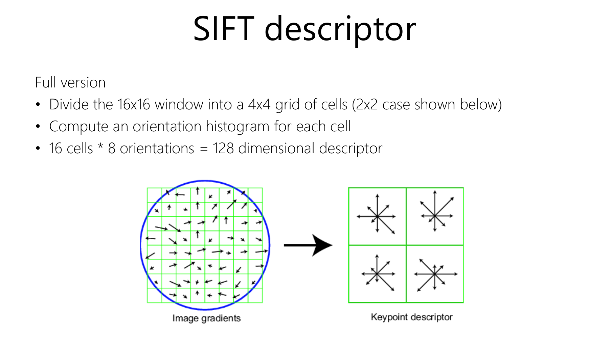

*[Lecture 6, PDF p. 56](Slides/06_image-features-ii.pdf) — SIFT stores orientation histograms over spatial cells.*

### Matching and ambiguity

For descriptors f,g, Euclidean distance is $\Vert f-g\Vert _2$. A small absolute distance can still be ambiguous when many features look alike.

The nearest-neighbor ratio is

$$
r=\frac{d(f,g_{\mathrm{best}})}{d(f,g_{\mathrm{second}})}.
$$

Accept if $r<\tau$. A small ratio means the best candidate is substantially better than the runner-up; a ratio near 1 indicates ambiguity. A ratio threshold is not a probability. Keep distance definitions consistent: a threshold for Euclidean distances is not numerically the same as one for squared distances.

**Example:** distances 10 and 12 give $r\approx0.833$; distances 10 and 40 give r = 0.25. At $\tau=0.7$, only the second pair is accepted. RANSAC later checks geometric consistency of accepted matches.

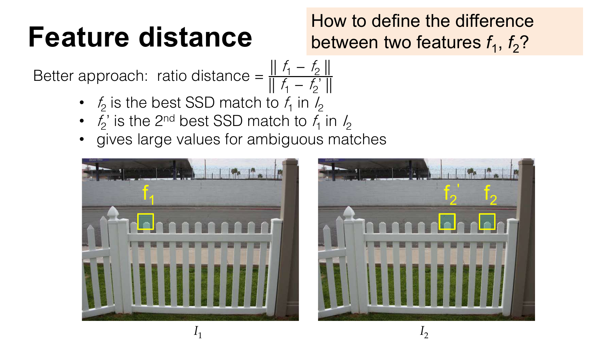

*[Lecture 6, PDF p. 66](Slides/06_image-features-ii.pdf) — Compare the best descriptor match with the runner-up to reject ambiguity.*

### Evaluation

$$
\mathrm{Precision}=\frac{TP}{TP+FP},\qquad
\mathrm{Recall}=\mathrm{TPR}=\frac{TP}{TP+FN},\qquad
\mathrm{FPR}=\frac{FP}{FP+TN}.
$$

An ROC curve plots TPR against FPR as the acceptance threshold varies. Higher ROC AUC is better; 1 is ideal. Precision–recall curves instead show the fraction of accepted matches that are correct versus the fraction of true matches recovered.

When accepting distances **below** a threshold, increasing that threshold admits more matches, so both TP and FP counts can increase. Recall cannot decrease for a fixed scored candidate set; precision need not change monotonically.

**Slide example:** Of 800 true and 200 false candidate matches, accept 600 true and 100 false. Recall $=600/800=0.75$, FPR $=100/200=0.5$, precision $=600/700\approx0.857$. FPR and 1-precision have different denominators.

## Lecture 7: Machine learning for computer vision

**Source:** [Lecture 7](Slides/07_ml-for-cv.pdf), learning and least squares pp. 18–75; classification/loss pp. 76–92; generalization pp. 93–113.

### Learning setup

Learning chooses parameters of a function using examples. Identify the **data, input/output representation, hypothesis space, loss, and optimizer**.

- **Supervised learning:** examples include target outputs, such as class labels, boxes, or depth.
- **Unsupervised learning:** learn structure without supplied task labels; reconstruction is one example of a training signal.
- **Regression:** real-valued outputs, such as coordinates or depth.
- **Classification:** discrete categories. A classifier can output continuous scores/probabilities before selecting a category.

Nearest-neighbor classification predicts using a nearby training example under a distance metric. Raw pixel distances are sensitive to shifts and appearance changes; good features can provide a more useful representation.

### Linear and polynomial regression

For $\hat y=w^Tx+b$, least squares minimizes

$$
L(w,b)=\frac{1}{N}\sum_{i=1}^N(\hat y_i-y_i)^2.
$$

Put a constant 1 into each feature vector to absorb the bias, then use a design matrix X. The least-squares solution is $X^+y$; if $X^TX$ is invertible, it is $(X^TX)^{-1}X^Ty$.

Polynomial regression uses features such as $[1,x,x^2,\ldots,x^d]$. It is nonlinear in the input x but linear in its learned coefficients. Increasing degree increases capacity and can cause overfitting.

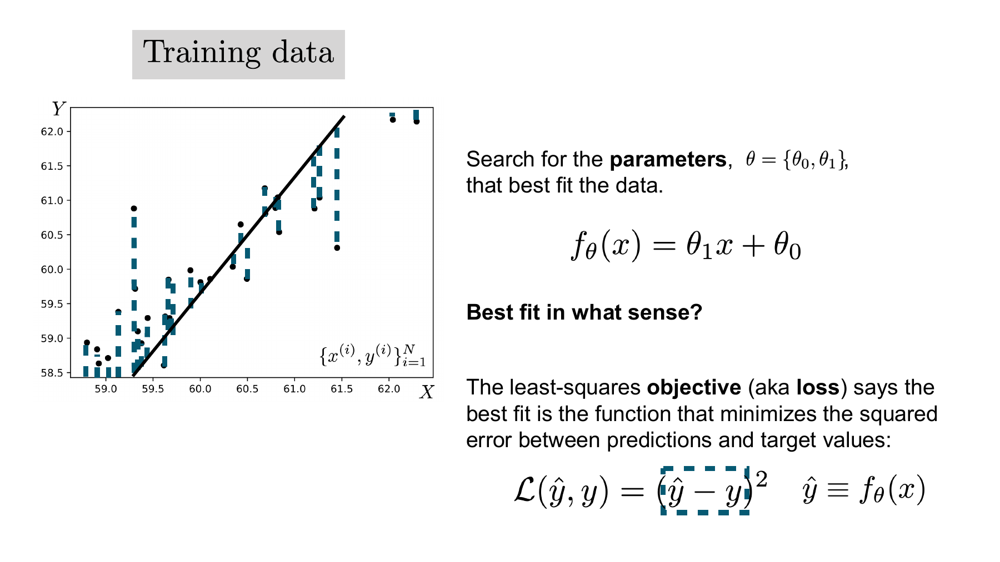

*[Lecture 7, PDF p. 47](Slides/07_ml-for-cv.pdf) — Learning selects parameters by minimizing prediction error.*

### Classification and loss

A linear classifier computes scores z = Wx+b. For C classes, W has shape $C\times D$ when $x\in\mathbb{R}^D$ is a column vector.

$$
p_c=\frac{e^{z_c}}{\sum_j e^{z_j}},\qquad L=-\sum_c y_c\log p_c.
$$

For a one-hot target, cross-entropy is $-\log p_{\mathrm{true}}$. A correct-class probability of 0.8 gives loss about 0.223; 0.1 gives about 2.303. Softmax converts logits to a probability vector; cross-entropy compares that vector with the target. Cross-entropy being a useful surrogate does not make neural-network training convex in all network parameters.

### Generalization

| Situation | Training behavior | Behavior on new data | Typical response |
|---|---|---|---|
| Underfitting | High error | High error | Better features/capacity or better optimization. |
| Overfitting | Low error | Substantially worse error | More representative data, augmentation, regularization, lower capacity, or early stopping. |
| Distribution shift | May look good | Failure in a changed domain | Check whether training covers the deployment conditions. |

Training data fit parameters; validation data guide choices such as learning rate or model capacity; held-out test data assess final performance. Repeated tuning on the test set compromises that evaluation.

**Explain:** Why is a degree-10 polynomial that passes through training points not necessarily better than a degree-2 polynomial? It may fit noise or behave poorly between/away from observations.

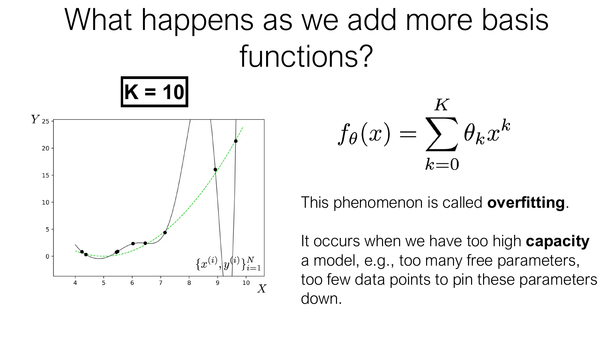

*[Lecture 7, PDF p. 107](Slides/07_ml-for-cv.pdf) — A high-capacity model can follow training samples while missing the underlying trend.*

## Lecture 8: Neural networks

**Source:** [Lecture 8](Slides/08_ml-for-cv-ii.pdf), linear limitations pp. 24–27; scores, neurons, and networks pp. 45–89.

A neuron computes

$$
z=w^Tx+b,\qquad a=\phi(z).
$$

The weights select a direction in feature space, the bias shifts the threshold, and the activation introduces nonlinearity. Common activations are the step function, sigmoid, tanh, and ReLU max(0,z).

Stacked layers form a composition. For example,

$$
f(x)=W_2\phi(W_1x+b_1)+b_2.
$$

Without nonlinear activations, multiple affine layers collapse into one affine map. Depth alone would not create nonlinear decision boundaries. XOR illustrates the need: its two positive examples cannot be separated from its two negative examples by one line, but a network with nonlinear hidden units can represent it.

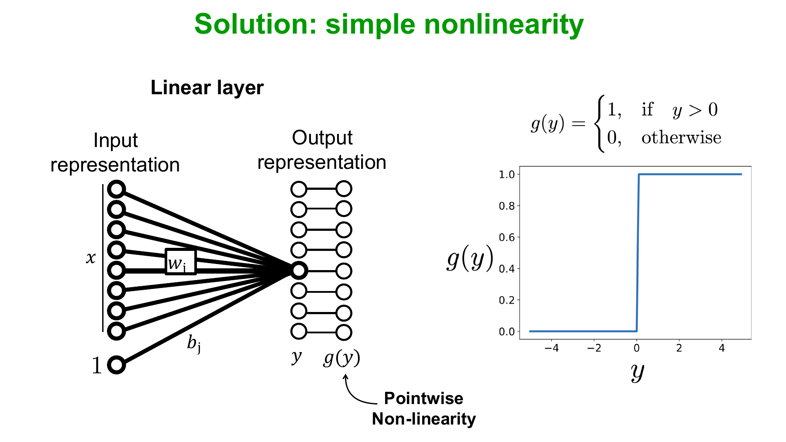

*[Lecture 8, PDF p. 59](Slides/08_ml-for-cv-ii.pdf) — A nonlinear activation follows the weighted linear computation.*

### Parameter counting

A fully connected layer from $n_{\mathrm{in}}$ to $n_{\mathrm{out}}$ has

$$
n_{\mathrm{in}}n_{\mathrm{out}}+n_{\mathrm{out}}=(n_{\mathrm{in}}+1)n_{\mathrm{out}}
$$

trainable parameters when each output has a bias. The input values themselves are not trainable parameters.

**Examples:** A $256\to128$ layer has 256(128)+128 = 32,896 parameters. A $3\to4\to2$ network has (3+1)4+(4+1)2 = 26. Count each layer separately, including each layer's biases.

**ImageNet/AlexNet:** Understand why a large labeled dataset, computation, and trainable hierarchical representations helped image recognition. The exam-relevant idea is the learned representation and training setup, rather than memorizing every historical detail.

## Lecture 9: Gradient descent and backpropagation

**Source:** [Lecture 9](Slides/09_ml-for-cv-iii.pdf), parameter counts pp. 14–19; optimization pp. 28–54; backpropagation pp. 55–86.

### Training loop

1. Forward pass: compute predictions.
2. Compute the loss.
3. Backward pass: compute derivatives of loss with respect to parameters.
4. Optimizer step: update parameters.
5. Repeat over training batches; check validation behavior.

$$
\theta_{\mathrm{new}}=\theta-\eta\nabla_\theta L.
$$

The gradient points toward local steepest increase; its negative points toward decrease. The learning rate $\eta$ controls step size. Too small can make progress slow; too large can overshoot, oscillate, or diverge. Slow progress alone does not prove the learning rate is the only problem.

- Batch GD uses the full dataset per update.
- SGD uses one example per update in its strict meaning.
- Mini-batch SGD uses a subset; this is common in practice.

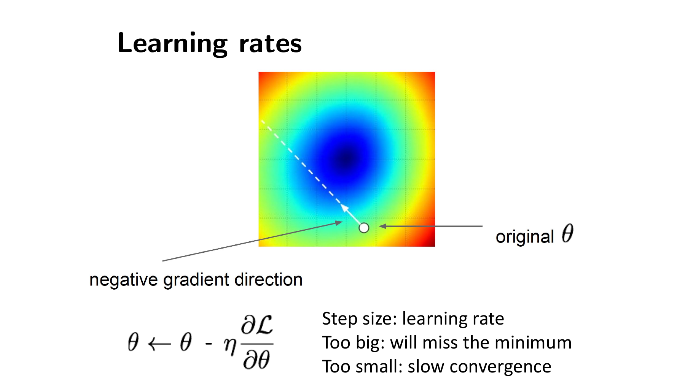

*[Lecture 9, PDF p. 51](Slides/09_ml-for-cv-iii.pdf) — The learning rate controls optimization step size.*

### Backpropagation is the chain rule

For a scalar neuron z = wx+b, $a=\phi(z)$, $L=\frac{1}{2}(a-y)^2$:

$$
\frac{\partial L}{\partial w}=(a-y)\phi'(z)x,\qquad
\frac{\partial L}{\partial b}=(a-y)\phi'(z).
$$

For an affine layer z = Wx+b with upstream derivative $\delta=\frac{\partial L}{\partial z}$:

$$
\frac{\partial L}{\partial W}=\delta x^T,\qquad
\frac{\partial L}{\partial b}=\delta,\qquad
\frac{\partial L}{\partial x}=W^T\delta.
$$

At a branch in a computation graph, sum the gradient contributions from all downstream paths. Backprop computes gradients; gradient descent uses them to change parameters. They are not synonymous.

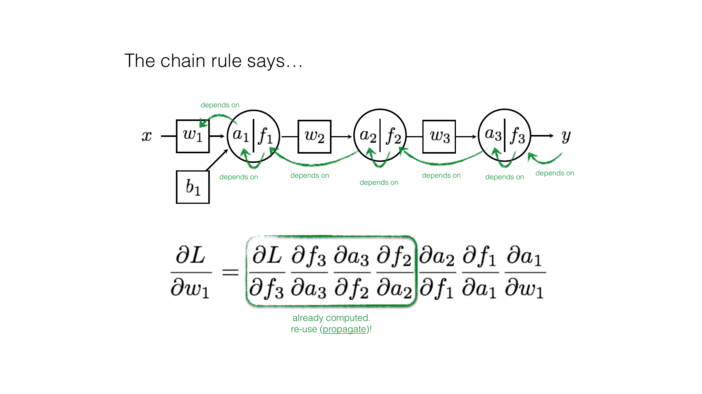

*[Lecture 9, PDF p. 80](Slides/09_ml-for-cv-iii.pdf) — The chain rule reuses downstream derivatives during backpropagation.*

**Worked update:** Let $\hat y=wx+b$, x = 2, y = 5, w = 1, b = 0, and $L=\frac{1}{2}(\hat y-y)^2$. Then $\hat y=2$, L = 4.5, $\frac{\partial L}{\partial w}=-6$, and $\frac{\partial L}{\partial b}=-3$. With $\eta=0.1$, the simultaneous updates are w = 1.6, b = 0.3. The new prediction is 3.5, closer to 5.

**Common mistakes:** adding the gradient; dropping the learning rate; forgetting an activation derivative; mixing loss conventions with and without the $1/2$ factor; updating one parameter before computing the other gradient from the same forward pass.

## Lecture 10: Convolutional neural networks

**Source:** [Lecture 10](Slides/10_cnn.pdf), convolution and dimensions pp. 12–70; pooling pp. 73–78; convolution variants and architectures pp. 79–94; interpretation pp. 111–135.

### Why convolution?

Convolutional layers use local connections and **share filter weights across spatial positions**. Filters span all input channels in a standard dense convolution. Each output channel has its own filter and usually one bias.

Early layers can learn edges/textures; later layers combine features into more task-specific patterns. The final classification layer can be linear because earlier layers have transformed the representation.

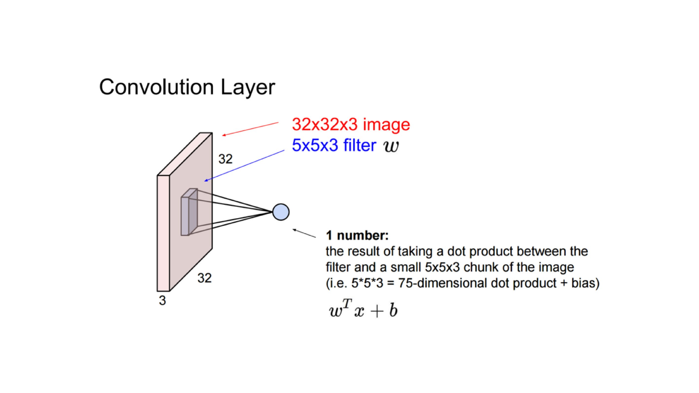

*[Lecture 10, PDF p. 40](Slides/10_cnn.pdf) — A convolution filter spans the input channels and produces spatial responses.*

### Output dimensions and parameters

For input $H\times W\times C_{\mathrm{in}}$, kernel $K_h\times K_w$, symmetric padding $P_h,P_w$, strides $S_h,S_w$, and dilation 1:

$$
H_{\mathrm{out}}=\left\lfloor\frac{H+2P_h-K_h}{S_h}\right\rfloor+1,
$$

$$
W_{\mathrm{out}}=\left\lfloor\frac{W+2P_w-K_w}{S_w}\right\rfloor+1.
$$

Output channels equal the number of filters, $C_{\mathrm{out}}$. Trainable parameters are

$$
(K_hK_wC_{\mathrm{in}}+1)C_{\mathrm{out}}.
$$

Use the floor when the last stride does not land exactly at the boundary. Padding is added on both sides. Parameter count does not grow with input image width/height, because weights are shared.

**Quiz-sized example:** H = W = 7, K = 4, S = 3, P = 2:

$$
H_{\mathrm{out}}=W_{\mathrm{out}}=\lfloor(7+4-4)/3\rfloor+1=3.
$$

The padded input has width 11; valid kernel starts are 0, 3, and 6. The output is 3 × 3 per filter.

**Full example:** 32 × 32 × 3 input, sixteen 3 × 3 filters, stride 1, padding 1 → 32 × 32 × 16 output and $(3\cdot3\cdot3+1)16=448$ parameters. A following 2 × 2 max-pool with stride 2 gives 16 × 16 × 16 and no learned weights. Flattening gives 4,096 values; a dense layer to 10 classes has 4096(10)+10 = 40,970 parameters.

### Pooling and convolution variants

| Operation | Purpose | Important distinction |
|---|---|---|
| Max/average pooling | Summarize a spatial neighborhood, often downsample. | Usually no trainable parameters; improves stability to small shifts but loses precise location. |
| 1 × 1 convolution | Mix input channels at each location; change channel count. | Has trainable parameters even though spatial kernel size is 1. |
| Dilated convolution | Increase receptive field without densely sampling every position. | Effective kernel size is D(K-1)+1. |
| Transposed convolution | Learned expansion/upsampling. | Applies the transpose of a convolution's linear map; it is not generally its inverse. |

For dilation D, replace K by D(K-1)+1 in the output-size formula. A 3 × 3 kernel with dilation 2 has a 5 × 5 effective footprint but still only nine spatial weights per input/output channel pair.

A layer's **receptive field** is the input region affecting its output. Stacking layers grows it. Convolution is translation-equivariant in an ideal setting; padding, boundaries, and stride complicate exact equivariance. Pooling does not guarantee invariance to arbitrary translations or rotations.

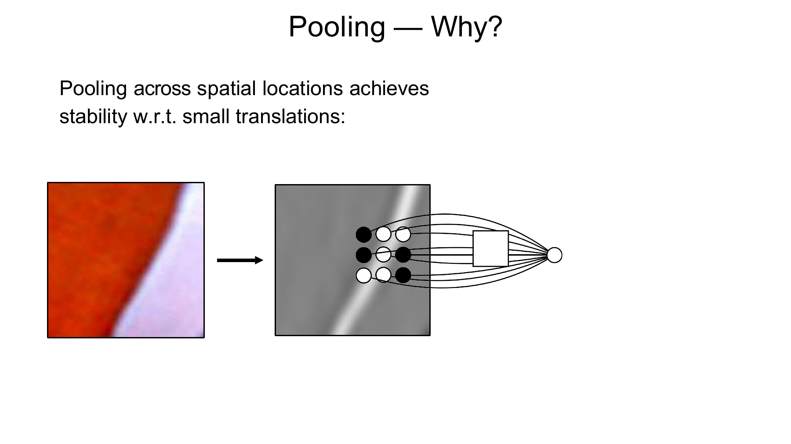

*[Lecture 10, PDF p. 73](Slides/10_cnn.pdf) — Pooling makes responses more stable under small shifts.*

### Architectures and interpretation

- **VGG:** deep stacks of small convolutions.
- **ResNet:** residual/skip paths, conceptually y = x+F(x), support optimization of deep networks.
- **Autoencoder:** encoder compresses to a latent representation; decoder reconstructs the input.
- **U-Net:** encoder–decoder with skip connections that restore/use spatial detail for image-to-image tasks.
- **Saliency/occlusion analysis:** inspect which pixels affect a class score; learned features may exploit unwanted correlations, such as snow rather than the animal itself.

**Practice:** Given any small CNN, write the tensor shape and parameter count after every layer. Distinguish the number of activations from the number of learned parameters.

## Lecture 11: Object detection

**Source:** [Lecture 11](Slides/11_object-detection.pdf), detector progression pp. 18–58; evaluation/NMS pp. 60–67.

Detection predicts **what** and **where**, potentially for multiple objects. A prediction includes a class, confidence, and box coordinates. Classification assigns an image label; semantic segmentation labels pixels.

### How the architectures differ

| Method | Main pipeline | Main limitation or improvement |
|---|---|---|
| Sliding window | Classify many positions, scales, and aspect ratios. | Expensive; many overlapping candidates. |
| HOG + classifier | Represent each window by orientation histograms. | Hand-designed representation; multiscale search is still needed. |
| R-CNN | External region proposals → crop/warp each region → separate CNN feature computation → classify/refine. | Repeats expensive CNN work for many regions. |
| Fast R-CNN | Compute shared CNN feature map once → RoI pooling → classify and refine proposals. | Still uses external proposals. |
| Faster R-CNN | Shared feature map → learned region proposal network (RPN) → region classification/refinement. | Learns proposals and shares features. |
| YOLO, as introduced in the lecture | Predict classes, confidence, and boxes directly from a grid/features in one stage. | Direct single-stage detection; do not generalize old benchmark numbers to all later versions. |

**RoI pooling** divides a proposed feature-map region into a fixed grid and pools each bin. Different region sizes become fixed-size features. An **anchor** is a reference box used for objectness and box-offset predictions; it is not the 3 × 3 feature window itself.

The lecture's original YOLO example uses a 7 × 7 grid, 20 class scores, and 2 boxes with 5 values each: $7\times7\times[20+2(5)]=7\times7\times30$.

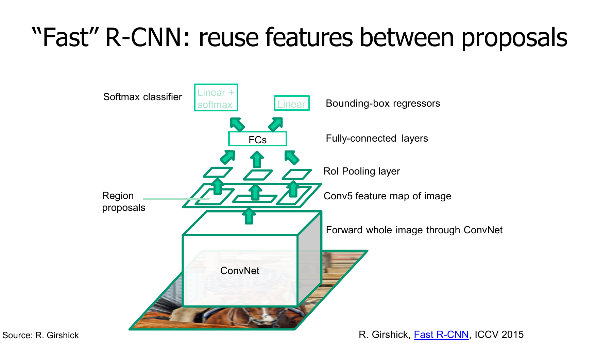

*[Lecture 11, PDF p. 39](Slides/11_object-detection.pdf) — Fast R-CNN shares convolutional features across region proposals.*

### Evaluation and duplicate removal

$$
\mathrm{IoU}(A,B)=\frac{\mathrm{Area}(A\cap B)}{\mathrm{Area}(A\cup B)}.
$$

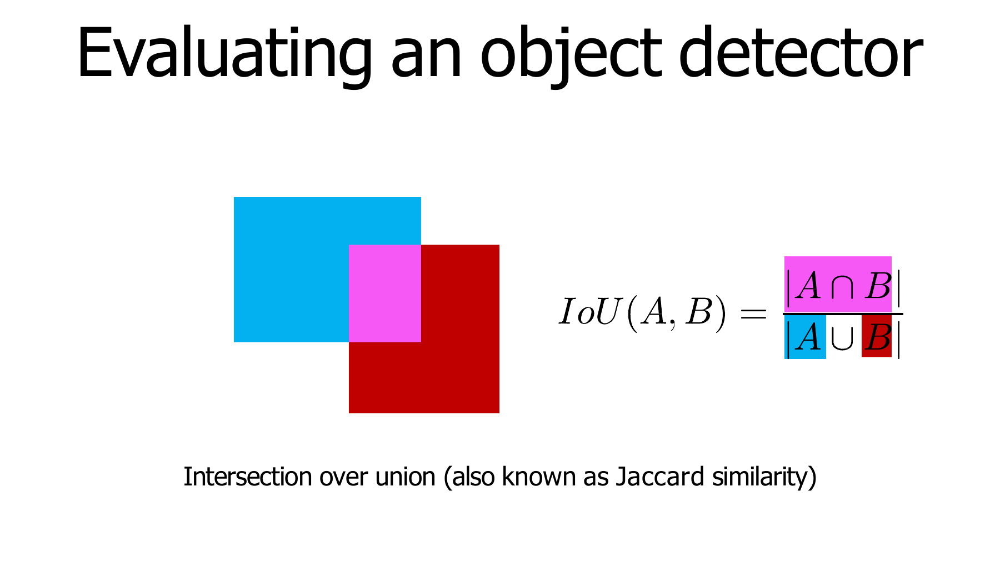

*[Lecture 11, PDF p. 62](Slides/11_object-detection.pdf) — Intersection over union measures bounding-box overlap.*

A correct detection requires the correct class and sufficient overlap under the chosen evaluation rule. The slides illustrate a 0.5 IoU threshold; it is a specified criterion, not a universal constant. Predictions are matched to ground-truth instances; repeated boxes for the same object can count as false positives.

- Precision: fraction of predicted detections that are true positives.
- Recall: fraction of ground-truth objects recovered.
- AP: summarizes a class's precision–recall curve; numerical interpolation rules can vary.
- mAP: mean AP over classes, possibly also over several IoU thresholds in some protocols.

**Greedy non-maximum suppression:** within a class, keep the highest-score box, suppress remaining boxes with excessive IoU with it, and repeat. NMS reduces duplicate detections. Its overlap threshold and the evaluation IoU threshold serve different purposes.

**IoU example:** Two 2 × 2 boxes overlap in a 1 × 2 rectangle. Intersection = 2; union = 4+4-2 = 6; IoU = $1/3$.

## Lecture 12: Image transformations

**Source:** [Lecture 12](Slides/12_image-transformations.pdf), linear transforms pp. 19–34; homogeneous coordinates pp. 35–53; transformation families pp. 54–69.

### Homogeneous coordinates

Represent (x,y) by $(x,y,1)^T$. Any nonzero scalar multiple represents the same point: $(2x,2y,2)^T\sim(x,y,1)^T$. Convert $(a,b,c)^T$ back to Cartesian coordinates as $(a/c,b/c)$ if $c\ne0$. A nonzero vector with last coordinate 0 represents a point at infinity; the all-zero vector is invalid.

Translation cannot be represented by a 2 × 2 linear matrix acting on (x,y) because a linear map must send the origin to the origin. Adding the homogeneous coordinate makes translation a matrix operation.

### Matrices to write from memory

$$
T(t_x,t_y)=\begin{bmatrix}1&0&t_x\\0&1&t_y\\0&0&1\end{bmatrix},\quad
S(s_x,s_y)=\begin{bmatrix}s_x&0&0\\0&s_y&0\\0&0&1\end{bmatrix},
$$

$$
R(\theta)=\begin{bmatrix}\cos\theta&-\sin\theta&0\\\sin\theta&\cos\theta&0\\0&0&1\end{bmatrix},\quad
\mathrm{Shear}_x(a)=\begin{bmatrix}1&a&0\\0&1&0\\0&0&1\end{bmatrix}.
$$

The rotation above is counterclockwise in mathematical coordinates with y increasing upward. Displayed image coordinates often increase downward, which changes the visual interpretation of the sign.

With column vectors, the **rightmost transform acts first**. Scale, then rotate, then translate is $\mathbf{x}'=TRS\mathbf{x}$. Rotation about a point c is T(c)RT(-c). In general, $TR\ne RT$.

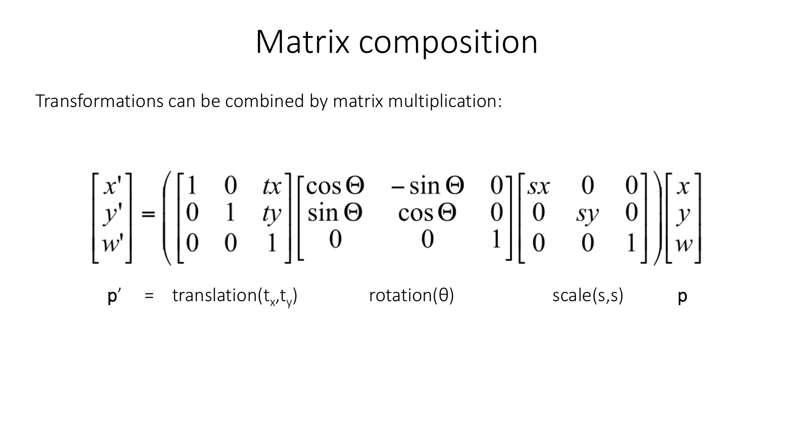

*[Lecture 12, PDF p. 53](Slides/12_image-transformations.pdf) — With column vectors, the rightmost transformation acts first.*

**Example:** Start at (1,0), rotate 90° counterclockwise, then translate by (2,1) → (2,2). Translate first, then rotate → (-1,3).

### Families and preserved properties

| Family | Form | Degrees of freedom | What is preserved? |
|---|---|---:|---|
| Translation | $x'=x+t$ | 2 | Lengths, angles, orientation, parallelism. |
| Euclidean/rigid | $x'=Rx+t$ | 3 | Lengths, angles, parallelism. |
| Similarity | $x'=sRx+t$ | 4 | Angles, length ratios, parallelism, circles. |
| Affine | $x'=Ax+t$ | 6 | Lines, parallelism, ratios along a line. Angles/lengths generally change. |
| Projective/homography | $x'\sim Hx$ | 8 | Lines and incidence; cross-ratios along a line. Parallelism generally changes. |

The similarity family has **4** DoF in 2D: scale 1 + rotation 1 + translation 2. Some overview slide labels are inconsistent; count independent parameters rather than memorizing the label.

Assume nonsingular transforms. General projective transforms need not preserve circles, squares, right angles, distances, or parallel lines. Railway tracks converging to a vanishing point are a counterexample to preserving parallelism. A circle viewed obliquely can become an ellipse, and a square can become a general quadrilateral.

## Lecture 13: Homographies, fitting, RANSAC, and stitching

**Source:** [Lecture 13](Slides/13_homographies.pdf), affine fitting pp. 2–12; homographies pp. 40–60; RANSAC pp. 61–80.

### Affine estimation

For a correspondence $(x,y)\leftrightarrow(u,v)$,

$$
u=ax+by+t_x,\qquad v=cx+dy+t_y.
$$

Stack equations for the six unknowns $(a,b,t_x,c,d,t_y)$. Each pair supplies two equations. **Three non-collinear pairs** suffice in the ideal case; use more and least squares with noisy data. Collinear data do not constrain a general 2D affine transformation fully.

### Applying and estimating a homography

Let $H=[h_{ij}]$. Then

$$
u=\frac{h_{11}x+h_{12}y+h_{13}}{h_{31}x+h_{32}y+h_{33}},\qquad
v=\frac{h_{21}x+h_{22}y+h_{23}}{h_{31}x+h_{32}y+h_{33}}.
$$

The denominator is essential. A 3 × 3 matrix has 9 entries but overall scale is irrelevant, so a homography has 8 DoF. **Four pairs in general position** provide the minimum: no three of the four should be collinear, in either image.

For row-major $h=(h_{11},h_{12},h_{13},h_{21},h_{22},h_{23},h_{31},h_{32},h_{33})^T$, each pair contributes two DLT rows:

$$
\begin{bmatrix}x&y&1&0&0&0&-ux&-uy&-u\\0&0&0&x&y&1&-vx&-vy&-v\end{bmatrix}
$$

Stack rows into A, solve $Ah\approx0$ with SVD and a norm constraint, and reshape h into H. Coordinate normalization improves conditioning. The map is rational in point coordinates, but cross-multiplication gives equations linear in the entries of H.

**When one homography is appropriate:** a planar scene, or camera rotation about a common optical center. General camera translation through a 3D scene causes depth-dependent parallax, so one homography usually cannot align everything.

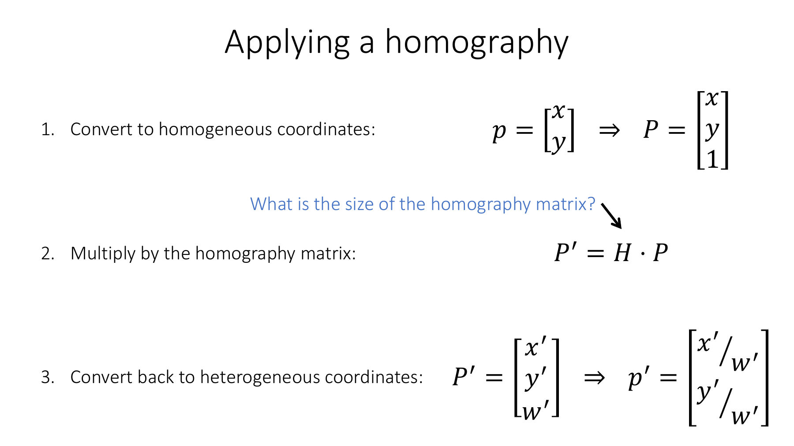

*[Lecture 13, PDF p. 44](Slides/13_homographies.pdf) — Apply a homography in homogeneous coordinates, then divide by the last coordinate.*

### RANSAC

Least squares can be pulled badly by incorrect matches. RANSAC estimates a model from random small subsets and checks agreement with all data:

1. Randomly choose a minimal nondegenerate subset.
2. Fit a candidate model.
3. Compute residuals for all correspondences.
4. Count inliers below a chosen error threshold.
5. Repeat; retain the strongest consensus.
6. Refit using all inliers of the selected model.

For homography fitting, sample four pairs. For translation alone, one pair determines the displacement. RANSAC identifies a model-supported inlier set; it does not make every correspondence correct or guarantee success after any fixed small number of trials.

An optional useful trial-count relationship is

$$
N\geq\frac{\log(1-p)}{\log(1-w^s)},
$$

where p is desired probability of at least one all-inlier sample, w is inlier fraction, and s is sample size. More outliers or a larger minimal sample requires more trials.

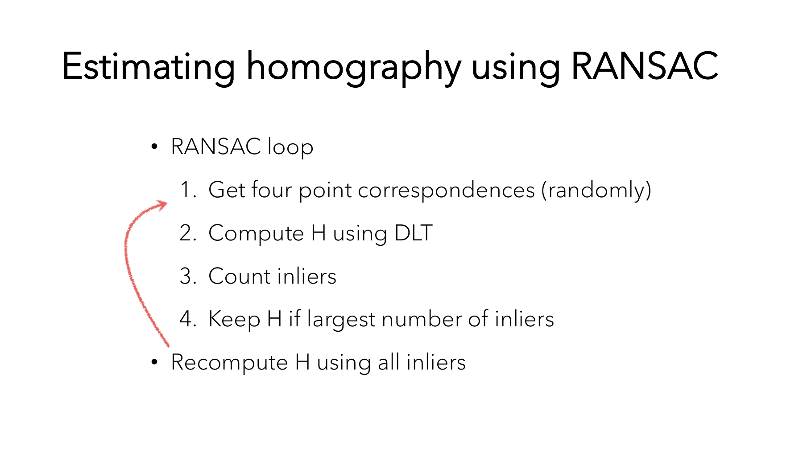

*[Lecture 13, PDF p. 80](Slides/13_homographies.pdf) — Estimate a candidate homography from four pairs, score inliers, and refit.*

### Stitching pipeline

**Detect → describe → match → reject ambiguous matches → estimate H robustly → warp → blend.**

Geometric alignment and photometric blending solve different problems. A perfect seam cannot repair large parallax errors. For inverse warping, visit an output pixel, map it back through $H^{-1}$, and interpolate the source image. This helps avoid the holes that forward mapping can leave.

**Matrix distinction:** A homography maps an image point to another image point. The fundamental matrix later maps an image point to a line of possible matches.

## Lecture 14: Camera models and calibration

**Source:** [Lecture 14](Slides/14_camera-models.pdf), projection/decomposition pp. 2–30; alternate models pp. 40–55; calibration pp. 57–92.

### World → camera → image

$$
\mathbf{x}\sim P\mathbf{X},\qquad P=K[R\mid\mathbf{t}],\qquad \mathbf{t}=-R\mathbf{C}.
$$

In Cartesian 3D coordinates, $X_c=R(X_w-C)=RX_w+t$. The intrinsic matrix is commonly

$$
K=\begin{bmatrix}f_x&s&c_x\\0&f_y&c_y\\0&0&1\end{bmatrix}.
$$

- **Extrinsics:** R,t locate and orient the camera relative to a world frame. R is 3 × 3 and has 3 rotational DoF; t is 3 × 1.
- **Intrinsics:** focal scales in pixels, principal point, and optional skew. They convert normalized camera coordinates into pixel coordinates.
- P is 3 × 4, K is 3 × 3, and homogeneous X is 4 × 1.

For zero skew, $u=f_xX_c/Z_c+c_x$ and $v=f_yY_c/Z_c+c_y$. The perspective divide loses depth: one image pixel defines a viewing ray rather than a unique 3D point.

**Worked example:** $f_x=f_y=800$ px, $(c_x,c_y)=(320,240)$, $X_c=(1,0.5,4)$ → (u,v) = (520,340) px. Keep focal length units consistent: millimeters cannot be substituted directly for focal length in pixels.

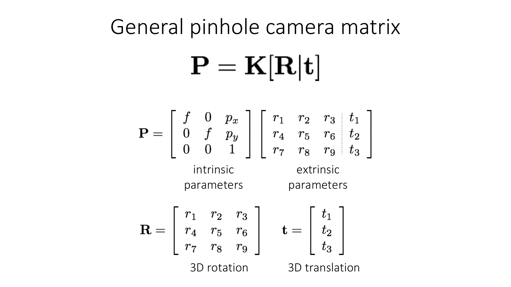

*[Lecture 14, PDF p. 26](Slides/14_camera-models.pdf) — Intrinsics and extrinsics combine in the camera projection matrix.*

### Perspective versus weak perspective

Perspective divides by each point's own Z. Weak perspective replaces that depth by a representative $Z_0$, giving approximately a uniform scale $f/Z_0$ across an object. It is appropriate when depth variation is small relative to mean viewing distance. Orthographic projection is a special parallel-projection case; in aligned normalized coordinates it keeps X,Y and drops Z.

### Geometric calibration

Given known 3D points and their image correspondences, estimate P, then recover intrinsic/extrinsic parameters. A general P has 11 DoF up to scale; each 3D–2D pair gives two independent constraints, so the linear formulation needs at least **six suitably arranged pairs**. Degenerate configurations, such as all points on a single plane for unconstrained one-view estimation of a general P, cannot determine everything.

Write $\mathbf{x}\times P\mathbf{X}=0$, keep two independent equations per pair, and solve the homogeneous system. After estimating $P=[M\mid p_4]$:

- The homogeneous camera center satisfies $PC_h=0$; find its right nullspace using SVD.
- If M is invertible, the Cartesian center is $C=-M^{-1}p_4$.
- Factor M = KR, with K upper triangular and R orthogonal, then choose consistent signs/scales.

**Notation clarification:** Lecture 14 p. 80 labels the decomposition “QR.” The required factor order is upper-triangular then orthogonal, so it is normally called **RQ decomposition**; QR can be adapted by reversing/transposing axes. The camera center is a right-nullspace/singular-vector calculation, not an eigenvector of the rectangular P itself.

Practical checkerboard calibration uses a known planar pattern viewed from several poses to recover intrinsics and per-view poses. Lens distortion requires additional modeling; barrel and pincushion distortion bend lines in ways an ideal pinhole model does not capture.

## Lecture 15: Triangulation and epipolar geometry

**Source:** [Lecture 15](Slides/15_epipolar-geometry.pdf), triangulation pp. 8–24; epipolar geometry pp. 25–47; essential matrix pp. 48–75; fundamental matrix/eight-point algorithm pp. 82–100.

### Triangulation: recover a point from two rays

Given camera matrices $P,P'$ and corresponding image points $x,x'$, estimate 3D X. Ideally the two viewing rays intersect; with noise, they usually do not intersect exactly.

For image point (u,v) and camera rows $p_1^T,p_2^T,p_3^T$:

$$
(u p_3^T-p_1^T)X=0,\qquad(v p_3^T-p_2^T)X=0.
$$

Two views provide four rows of a 4 × 4 homogeneous system. Solve with SVD and dehomogenize X. Reprojection-error refinement can improve the linear estimate. Small baseline or nearly parallel viewing rays makes depth poorly constrained. Pure camera rotation does not provide a triangulation baseline.

### Geometry vocabulary

- **Baseline:** line joining the camera centers.
- **Epipole:** image of the other camera center; it may lie outside the visible image or at infinity.
- **Epipolar plane:** plane containing the two centers and a scene point.
- **Epipolar line:** intersection of that plane with an image plane.

The corresponding point in the second image must lie on the epipolar line. This reduces a 2D correspondence search to a 1D line search, but does not uniquely identify the match. All epipolar lines in an image pass through its epipole.

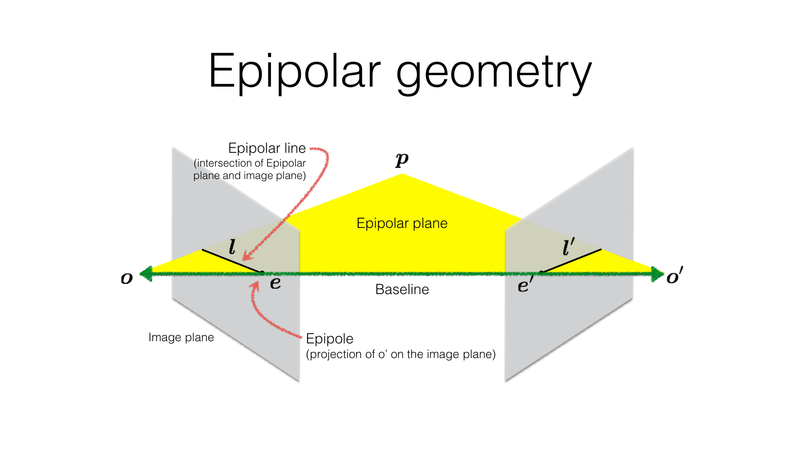

*[Lecture 15, PDF p. 30](Slides/15_epipolar-geometry.pdf) — The camera centers and scene point define an epipolar plane and image lines.*

### Essential and fundamental matrices

For normalized camera coordinates, $\hat x'^TE\hat x=0$. For pixel coordinates,

$$
x'^TFx=0,\qquad F=K'^{-T}EK^{-1}.
$$

Then $l'=Fx$ is the corresponding line in image 2 and $l=F^Tx'$ is the line in image 1. A line $l'=(a,b,c)^T$ contains points satisfying $au'+bv'+c=0$.

| Matrix | Size | Input/output meaning | Important property |
|---|---|---|---|
| H | 3 × 3 | Image point → image point. | 8 DoF; invertible for a valid homography. |
| E | 3 × 3 | Normalized point → epipolar line. | Rank 2; two equal nonzero singular values; 5 DoF for nonzero baseline. |
| F | 3 × 3 | Pixel point → epipolar line. | Rank 2; 7 DoF. |
| P | 3 × 4 | 3D homogeneous point → image point. | General projection, 11 DoF up to scale. |

**Essential matrix conventions:** If camera-2 coordinates satisfy $X_2=RX_1+t$, use $E=[t]_\times R$, where $[t]_\times a=t\times a$. The lecture instead writes $X'=R(X-t_{\mathrm{center}})$ and obtains $E\sim R[t_{\mathrm{center}}]_\times$ (p. 69). These are consistent after changing the meaning of translation and allowing overall sign. Do not mix one convention's t with the other's formula.

To understand the derivation, draw the two rays and the baseline in one plane. A cross product gives a normal to that plane; dotting with the other coplanar ray gives zero. This scalar triple product becomes the epipolar constraint.

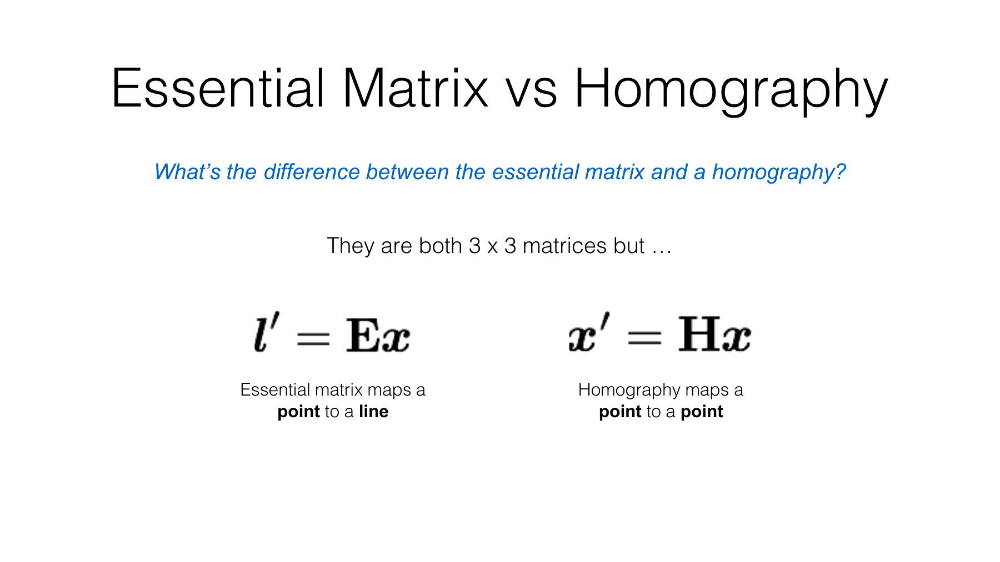

*[Lecture 15, PDF p. 53](Slides/15_epipolar-geometry.pdf) — A homography maps point to point; an essential matrix gives an epipolar line.*

### Normalized eight-point algorithm

For $(u,v,1)^T\leftrightarrow(u',v',1)^T$, one row of A is

$$
\begin{bmatrix}u^{\prime}u&u^{\prime}v&u^{\prime}&v^{\prime}u&v^{\prime}v&v^{\prime}&u&v&1\end{bmatrix}
$$

1. Normalize coordinates in each image for numerical conditioning, typically centering them and scaling their average distance from the origin to sqrt(2).
2. Build A from at least eight correspondences in a nondegenerate configuration.
3. Solve $Af\approx0$ using SVD and reshape into a 3 × 3 estimate.
4. Enforce rank 2 by replacing the smallest singular value of that matrix with zero.
5. Undo coordinate normalization: if $x_n=Tx$ and $x'_n=T'x'$, then $F=T'^TF_nT$.
6. Use RANSAC to handle mismatches.

**Why eight pairs if F has seven DoF?** The linear solver treats 9 entries up to scale and uses eight linear constraints, then enforces rank 2. A different seven-point method exists; it is not the linear eight-point algorithm in the review.

**Critical contrast:** Homography estimation obtains **two** independent equations per matched pair; the epipolar constraint gives **one**. Eight-point coordinate normalization is numerical preprocessing; $K^{-1}x$ normalization uses camera calibration. They are different operations.

## Lecture 16: Stereo vision and depth

**Source:** [Lecture 16](Slides/16_stereo.pdf), stereo/triangulation pp. 18–24; disparity geometry pp. 25–40; rectification pp. 54–68; matching pp. 70–78.

### Rectified stereo

Rectification warps the two views so corresponding epipolar lines become horizontal, allowing same-row correspondence search. It does not mean the original cameras must have been physically parallel. After rectification, use the intrinsics/focal scales appropriate to the rectified views.

For parallel rectified views with common focal length f, baseline B, and compatible principal-point coordinates, define disparity $d=u_L-u_R$. Then

$$
Z=\frac{fB}{d}.
$$

Derivation: $u_L=fX/Z$, $u_R=f(X-B)/Z$; subtract to get $d=fB/Z$. Use coordinates with the principal-point offsets removed, or include their correction if the two offsets differ.

- Larger disparity means a nearer point.
- Small disparity means large depth.
- If $d\to0$, depth tends to infinity in the ideal model.
- f in pixels and d in pixels give Z in the units used for B.

**Worked example:** f = 800 px, B = 0.12 m, d = 24 px → Z = 4 m. At d = 12 px the depth is 8 m.

Depth sensitivity follows

$$
\left|\frac{\partial Z}{\partial d}\right|=\frac{fB}{d^2}=\frac{Z^2}{fB}.
$$

Thus a one-pixel disparity error is much more harmful for distant objects. A larger baseline can improve depth sensitivity but also makes matching and occlusion harder.

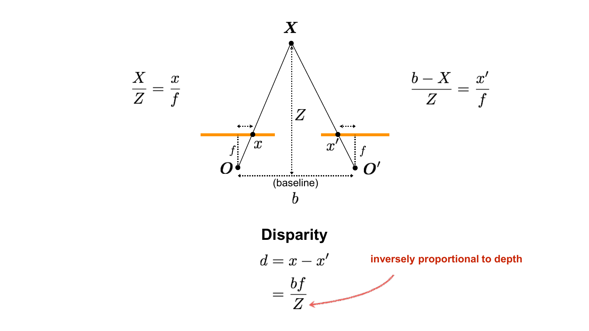

*[Lecture 16, PDF p. 40](Slides/16_stereo.pdf) — For rectified stereo, disparity is inversely proportional to depth.*

### Dense disparity estimation

1. Rectify the views.
2. For each reference pixel/window, search along its epipolar scanline over plausible disparities.
3. Compute a matching cost such as SSD, SAD, or normalized correlation.
4. Select/refine the best disparity; check consistency and handle invalid pixels.
5. Convert disparity to depth where the estimate is valid.

Small windows preserve boundaries but can be ambiguous/noisy. Large windows offer more evidence but can mix foreground and background. Failure cases include flat surfaces, repeated texture, occlusion, reflective surfaces, lighting differences, and mismatched scene content. Not every pixel has a visible corresponding point.

A learned monocular depth estimator uses cues and priors from training data. Stereo uses geometric correspondence and known calibration/baseline for metric depth. One image alone does not remove geometric scale ambiguity without additional assumptions or information.

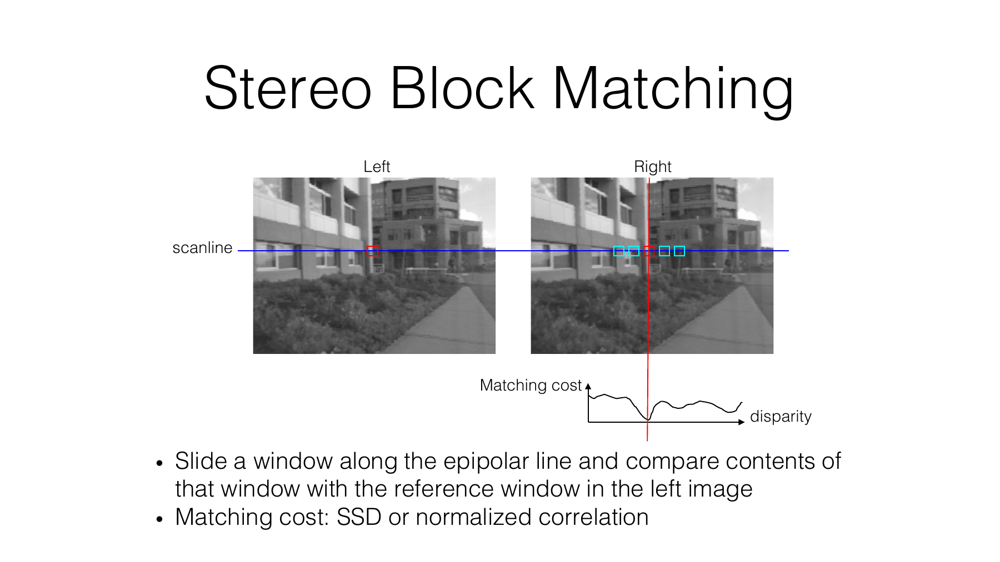

*[Lecture 16, PDF p. 78](Slides/16_stereo.pdf) — Search for a corresponding patch along the epipolar scanline.*

## Lecture 17: Structure from motion and optical flow

**Source:** [Lecture 17](Slides/17_motion.pdf), SfM pp. 5–31; flow and assumptions pp. 39–58; coarse-to-fine and applications pp. 65–78.

### Structure from motion

SfM estimates both 3D scene structure and camera motion/poses from overlapping images. It differs from triangulation with already-known cameras because camera parameters must also be recovered.

Typical pipeline:

1. Detect and describe local features.
2. Match image pairs and reject outliers using geometric verification/RANSAC.
3. Link pairwise matches into tracks across images.
4. Initialize camera poses and triangulate points.
5. Add cameras/points incrementally.
6. Jointly refine cameras and points with **bundle adjustment**.

Bundle adjustment minimizes reprojection error:

$$
\min_{\{R_j,t_j,X_i\}}\sum_{(i,j)\in\mathcal{O}}
\|x_{ij}-\pi(K_j[R_j\mid t_j]X_i)\|^2,
$$

where O is the observed point–image set and $\pi$ includes the perspective divide. It is a nonlinear optimization problem. With calibrated cameras, reconstruction is generally ambiguous up to a global similarity transform, including absolute scale, unless extra information fixes it. Static-scene assumptions, overlap, texture, and useful camera translation matter.

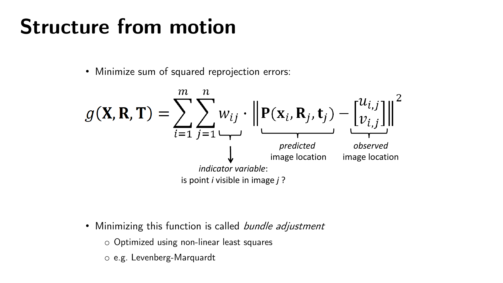

*[Lecture 17, PDF p. 25](Slides/17_motion.pdf) — Bundle adjustment jointly refines cameras and structure using reprojection error.*

### Motion field versus optical flow

- **Motion field:** projection of actual 3D motion into image coordinates.
- **Optical flow:** apparent motion of brightness/image patterns.

They can differ. Changing illumination can move a brightness pattern without moving the surface; a rotating uniform object may have physical motion with little visible intensity motion.

### Brightness constancy and the aperture problem

Assume a point's intensity is approximately unchanged between frames:

$$
I(x,y,t)\approx I(x+u,y+v,t+1).
$$

For small motion, first-order Taylor expansion gives

$$
I_xu+I_yv+I_t=0.
$$

There is one equation for two unknowns. Along a straight edge, motion parallel to the edge is not determined by local brightness changes. This is the **aperture problem**.

### Lucas–Kanade flow

Assume neighboring pixels have the same displacement (u,v). Stack their equations:

$$
A\begin{bmatrix}u\\v\end{bmatrix}=b,\qquad
A=\begin{bmatrix}I_x(p_1)&I_y(p_1)\\\vdots&\vdots\\I_x(p_n)&I_y(p_n)\end{bmatrix},\quad
b=-\begin{bmatrix}I_t(p_1)\\\vdots\\I_t(p_n)\end{bmatrix}.
$$

Then solve least squares. The normal matrix is

$$
A^TA=\begin{bmatrix}\sum I_x^2&\sum I_xI_y\\\sum I_xI_y&\sum I_y^2\end{bmatrix}.
$$

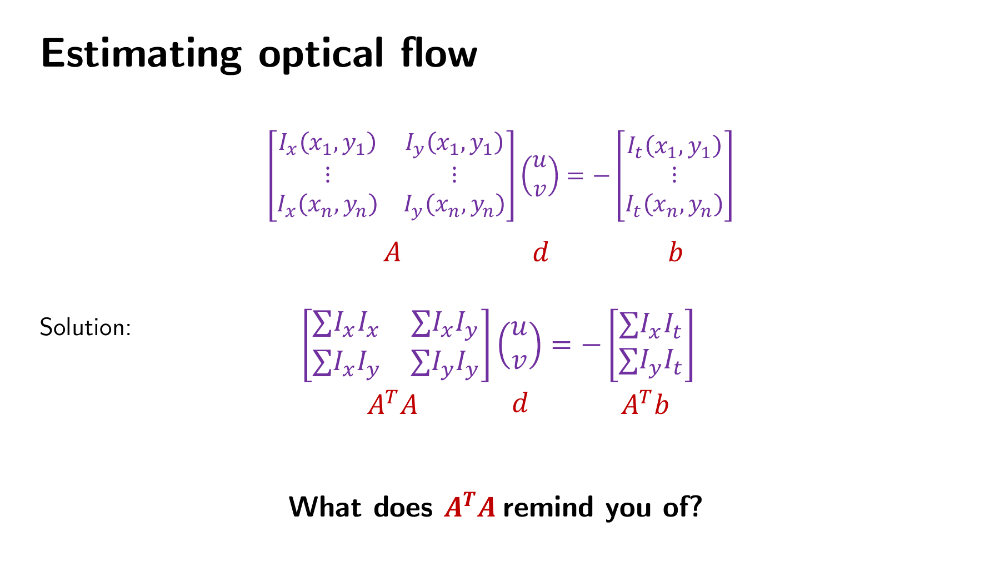

*[Lecture 17, PDF p. 54](Slides/17_motion.pdf) — Neighboring brightness-constancy constraints form a least-squares motion estimate.*

This is the same second-moment structure seen in Harris detection. Both eigenvalues must be sufficiently large for a stable two-component motion estimate. Corners are good; flat patches are uninformative; straight edges constrain only one direction.

**Three key assumptions:** approximate brightness constancy, small displacement for linearization, and locally coherent motion. Occlusion, illumination changes, motion boundaries, and large displacements violate them.

**Coarse-to-fine flow:** build image pyramids, estimate motion at a coarse scale where displacement is smaller in pixels, upsample and scale the flow, warp the second image toward the first, and refine at finer levels. Merely estimating unrelated flow at each level misses the refinement idea.

Applications include tracking, stabilization, frame interpolation, restoration, motion magnification, and action recognition. Optical flow describes image displacement; it is not by itself a unique metric 3D reconstruction.

## Lecture 18: Image synthesis

**Source:** [Lecture 18](Slides/18_image-synthesis.pdf), modeling pp. 3–11; AE/VAE pp. 13–48; GANs pp. 49–94.

### Discriminative versus generative modeling

- A discriminative model estimates $p(y\mid x)$, such as an object class given an image.
- An unconditional generative model represents/generates from p(x).
- A conditional generative model generates from $p(x\mid y)$, where y might be a label, image, or text description.

The goal is both plausible individual samples and coverage of the data's variation. Generating a few realistic examples does not show that the full distribution has been learned.

### Autoencoders

$$
z=\mathrm{Encoder}(x),\qquad \hat x=\mathrm{Decoder}(z),\qquad
L_{\mathrm{rec}}=\|x-\hat x\|^2.
$$

A bottleneck encourages compression/useful features. A denoising autoencoder takes a corrupted image and predicts the clean target. A convolutional decoder can upsample using transposed convolution or other upsampling methods.

**Limitation:** a basic reconstruction-trained AE does not necessarily organize its latent codes into a distribution that can be sampled easily. A random Gaussian vector need not decode to a realistic image.

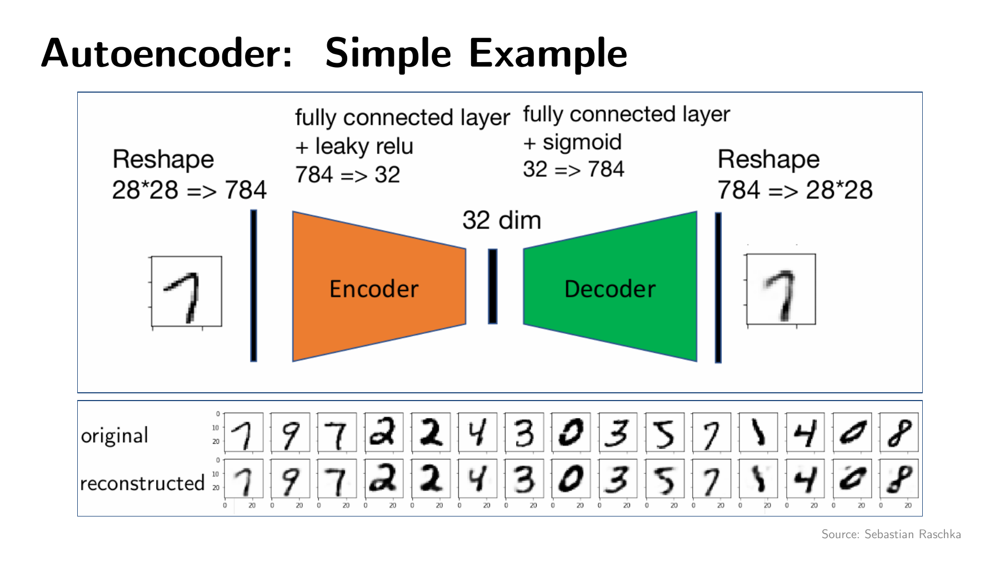

*[Lecture 18, PDF p. 16](Slides/18_image-synthesis.pdf) — An autoencoder reconstructs its input through a latent representation.*

### Variational autoencoders

A VAE imposes a probabilistic latent structure, commonly with a standard-normal prior p(z) = N(0,I). Its encoder represents a distribution over latent codes, and its decoder maps sampled codes toward image distributions. After training, sample a new z from the prior and decode.

For this lecture, focus on **why a latent prior enables sampling** and how an AE and VAE differ. As optional mathematical context, a VAE balances reconstruction against a KL penalty that encourages the approximate posterior to match the prior. Full ELBO derivations are not developed in the supplied lecture. A Gaussian prior alone does not guarantee interpretable/disentangled latent factors.

### Generative adversarial networks

- Generator G: random latent z → synthetic image G(z).
- Discriminator D: image → score for real versus fake.
- Train D to distinguish real samples from generated ones; train G to fool D.

The original minimax objective is

$$
\min_G\max_D\ \mathbb{E}_{x\sim p_{data}}[\log D(x)]
+\mathbb{E}_{z\sim p(z)}[\log(1-D(G(z)))].
$$

Alternate discriminator and generator updates. With D fixed during a generator update, gradients still flow through D to the generator. A common practical generator loss is $-\mathbb{E}_z\log D(G(z))$, which gives a more useful signal when the discriminator confidently rejects generated samples. At generation time, use G; a discriminator is not required to produce samples.

| Failure | Meaning |
|---|---|
| Vanishing generator gradients | A very successful discriminator can leave the original generator objective with weak gradients. |
| Non-convergence | The two players can oscillate instead of reaching equilibrium. |
| Mode collapse | Different latent inputs produce too little output diversity, missing parts of the data distribution. |

The lecture mentions Wasserstein GANs as an alternative objective/framework for improving training behavior. Understand the motivation without assuming GAN training has a universal convergence guarantee.

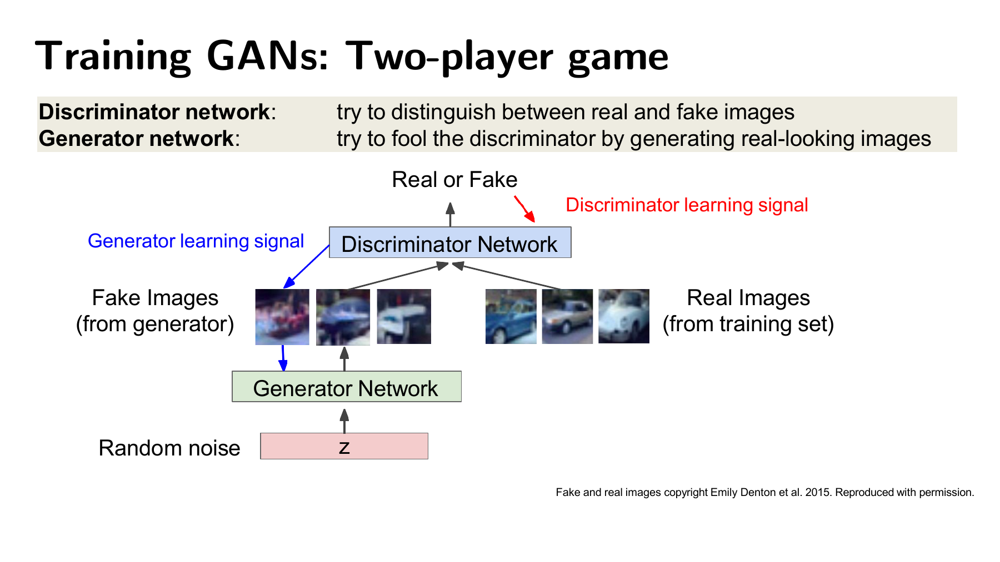

*[Lecture 18, PDF p. 64](Slides/18_image-synthesis.pdf) — A generator and discriminator provide opposing training signals.*

### Lecture 18a companion: text-to-image

**Source:** [Text-to-image deck](Slides/18a_text-to-image.pdf), conditional GANs pp. 12–23; autoregressive/latent models pp. 28–40; diffusion pp. 41–58; evaluation pp. 59–66.

| Model family | How generation works | Main idea to explain |
|---|---|---|
| Conditional GAN | Generator receives noise plus a text representation; discriminator supplies an adversarial signal. | Condition image generation on the prompt. |
| Autoregressive | Generate pixels or discrete image tokens one after another, conditioned on previous ones and text. | Factorize $p(x\mid c)=\prod_i p(x_i\mid x_{<i},c)$; sequential sampling can be slow. |
| VQ-based latent model | Encode images into a smaller grid of discrete codebook tokens; model that grid and decode it. | Shorter latent sequence makes modeling more manageable. |
| Diffusion | Add noise gradually during training; learn to reverse corruption by repeated denoising. | Generate by starting from noise and iterating learned denoising steps. |
| Latent diffusion | Perform diffusion in a compressed learned space, then decode to pixels. | Reduce computation compared with denoising full-resolution pixels. |

Text embeddings and cross-attention connect prompt information to image generation. Coarse-to-fine/cascaded systems increase resolution in stages. Distinguish the forward noising process from the learned reverse generation process.

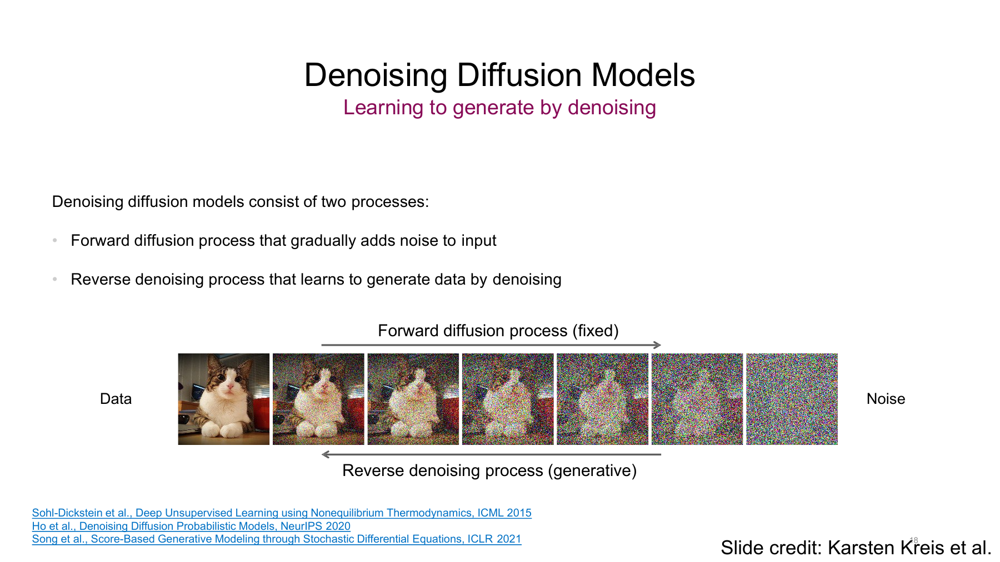

*[Lecture 18a, PDF p. 43](Slides/18a_text-to-image.pdf) — Forward diffusion adds noise; the learned reverse process denoises.*

For a useful mental model of diffusion: **clean image → progressively noisy image** defines training corruptions; **noise → repeated text-conditioned denoising → image** describes generation. It does not retrieve a matching training image as its formal generation rule.

Evaluation must consider prompt alignment, object presence, attributes, spatial relationships, compositionality, diversity, and efficiency. A beautiful image can still place “A left of B” incorrectly or generate the wrong number of objects. The deck's VISOR/ConceptBed examples motivate this distinction.

## Formula sheet

Know what each variable means, which units apply, and which assumptions make the formula valid.

**Pinhole projection**  
$u=\frac{fX}{Z}$, $v=\frac{fY}{Z}$ on the virtual plane.

**Thin lens**  
$1/f=1/s_o+1/s_i$; $\vert m\vert =\frac{s_i}{s_o}$.

**Field of view**  
$2\arctan(w/(2f))$ for sensor width w.

**Gaussian**  
$G_\sigma\propto e^{-(x^2+y^2)/(2\sigma^2)}$; normalize the discrete kernel.

**Gradient**  
$\nabla I=(I_x,I_y)$, magnitude $\sqrt{I_x^2+I_y^2}$.

**Detail/sharpening**  
$D=I-G*I$; $I_{\mathrm{sharp}}=I+\alpha D$.

**Convolution theorem**  
$\mathcal{F}(I*k)=\mathcal{F}(I)\mathcal{F}(k)$.

**Gaussian pyramid**  
Blur, then downsample.

**Laplacian pyramid**  
$L_k=G_k-\mathrm{Expand}(G_{k+1})$.

**Harris**  
$E(u,v)\approx[u\ v]M[u\ v]^T$, with $M=\sum w\nabla I\nabla I^T$.

**SIFT length**  
$4\times4\times8=128$.

**Ratio test**  
Best descriptor distance / second-best distance; accept small ratios.

**Precision / recall**  
$\frac{TP}{TP+FP}$ / $\frac{TP}{TP+FN}$.

**FPR**  
$\frac{FP}{FP+TN}$.

**Linear prediction**  
$\hat y=w^Tx+b$.

**Softmax / CE**  
$p_c=e^{z_c}/\sum_j e^{z_j}$; $L=-\log p_{\mathrm{true}}$.

**Dense parameters**  
$(n_{\mathrm{in}}+1)n_{\mathrm{out}}$, including bias.

**GD**  
$\theta\leftarrow\theta-\eta\nabla L$.

**Conv output, one axis**  
$\lfloor(N+2P-D(K-1)-1)/S\rfloor+1$.

**Conv parameters**  
$(K_hK_wC_{\mathrm{in}}+1)C_{\mathrm{out}}$ for standard convolution with biases.

**IoU**  
Intersection area / union area.

**Homogeneous point**  
$(x,y)\leftrightarrow(x,y,1)$; divide by final coordinate to return.

**Homography**  
$x'\sim Hx$; 8 DoF; minimum 4 suitable point pairs.

**Camera**  
$x\sim K[R\mid t]X$, t = -RC.

**Camera center**  
$PC_h=0$.

**Epipolar constraint**  
$\hat x'^TE\hat x=0$; $x'^TFx=0$.

**Intrinsics conversion**  
$F=K'^{-T}EK^{-1}$.

**Epipolar lines**  
$l'=Fx$, $l=F^Tx'$.

**Rectified stereo depth**  
$Z=\frac{fB}{d}$.

**Optical flow**  
$I_xu+I_yv+I_t=0$.

**Lucas–Kanade**  
Solve $A^TA\,[u\ v]^T=A^Tb$.

**AE**  
z = E(x), $\hat x=D(z)$, reconstruction loss.

**GAN**  
Generator versus discriminator; alternate adversarial updates.

### Minimum-data comparison

| Estimation problem | Constraints from one pair/view | Minimum for the stated formulation |
|---|---:|---|
| 2D translation | 2 | 1 matched pair. |
| 2D affine transform | 2 | 3 non-collinear matched pairs. |
| Homography | 2 | 4 matched pairs in general position. |
| General camera matrix | 2 per 3D–2D pair | 6 suitably arranged pairs. |
| Fundamental matrix, linear eight-point algorithm | 1 | 8 suitable matched image pairs. |
| Triangulate one 3D point with known cameras | 2 per image observation | 2 distinct views with useful baseline/correspondence. |

## Quiz review: explanations for quizzes 1–5

These are derived study explanations, **not an instructor-provided solution key**. The original sheets are linked for practice.

### Quiz 1: formation and filtering

**Source:** [Quiz 1](exam_review_material/quizzes/quiz_1.pdf).

1. The misconduct question contrasts using AI to complete work or finding answers online with using permitted late days. Under the policy described on the sheet/course materials, the first and third actions are the violations. This is a course-policy item rather than a vision derivation.
2. Thin lens: $1/s_o+1/s_i=1/f$ → **b**.
3. Bayer: 25% red, 50% green, 25% blue → **b**.
4. Gaussian filtering blurs/smooths → **b**.
5. Vertical-edge detector: opposite signs in the left/right columns → **b**. Reversing all signs changes polarity, not which edge orientation is detected.

### Quiz 2: frequency and pyramids

**Source:** [Quiz 2](exam_review_material/quizzes/quiz_2.pdf).

1. Fourier representation uses a sum of sinusoidal waves → **C**.
2. Transform of convolution is product of transforms → **True**.
3. Gaussian pyramid: blur before downsampling → **B**.
4. For the course's image-minus-Gaussian detail construction: $X-G*X$. If asked specifically for a Laplacian pyramid level, subtract the expanded next Gaussian level. A mathematical Laplacian derivative is $\nabla^2X$; do not treat the three expressions as identical.
5. Centered low-pass mask: pass/white near the center and reject/black outside. If drawing a Gaussian low-pass, use a smooth falloff.

### Quiz 3: SIFT and appearance changes

**Source:** [Quiz 3](exam_review_material/quizzes/quiz_3.pdf).

1. The simplified slide sequence is **c → d → a → e → b**: window, orientations, discard weak edges, histogram, dominant-bin alignment.
2. In the fountain images, geometric changes include viewpoint/perspective and resulting relative positions/foreshortening. Photometric changes include brightness, shadows, contrast, and color balance. Some visible content can also change, such as flowing water or occlusion; these need not be explained by one global geometric or photometric transform.

### Quiz 4: networks and convolution

**Source:** [Quiz 4](exam_review_material/quizzes/quiz_4.pdf).

1. Dense parameters: $256\cdot128+128=32{,}896$ → **c**.
2. The plotted curve oscillates strongly between training samples relative to the dotted true trend: **overfitting** → **a**.
3. Learning rate is the relevant listed hyperparameter → **c**. Increasing it cautiously can speed progress if it was too small; an excessive increase can destabilize training.
4. Stride is the number of input positions the kernel moves between adjacent output positions.
5. Output height and width are both $\lfloor(7+2\cdot2-4)/3\rfloor+1=3$ → **3 × 3**.

### Quiz 5: projective properties and translation

**Source:** [Quiz 5](exam_review_material/quizzes/quiz_5.pdf).

1. Under a nonsingular projective transformation: lines remain lines; parallel lines need not stay parallel; circles need not stay circles; squares need not stay squares. Draw converging tracks, a tilted circular disk, and a square seen obliquely as counterexamples. A line may map to the line at infinity in the projective plane.
2. The diagram translates by $t_x=2,t_y=1$. With homogeneous column vectors:

$$
\begin{bmatrix}x'\\y'\\1\end{bmatrix}=\begin{bmatrix}1&0&2\\0&1&1\\0&0&1\end{bmatrix}\begin{bmatrix}x\\y\\1\end{bmatrix}.
$$

## Self-test: try before reading the answers

These are new practice questions, not predictions or copied exam questions.

1. Why can one image point not uniquely determine a 3D point? Draw the set of possible points.
2. For a 40 mm lens focused on an object 400 mm away, find image distance and magnification magnitude.
3. What happens to DoF when aperture diameter decreases? What happens to FoV when focal length decreases at fixed sensor size?
4. Apply a normalized 3 × 3 box filter to a patch containing eight zeros and one value of 81.
5. Why does an x-derivative kernel detect vertical edges? What changes if all kernel signs are reversed?
6. Draw a centered low-pass Fourier mask. What happens if you suppress its center instead?
7. Explain how a Laplacian pyramid reconstructs the original image.
8. Derive the Harris quadratic approximation and classify eigenvalues (0.2,0.1), (80,0.2), and (60,45).
9. Why is a corner easier to track than a straight edge? Relate two lectures in your answer.
10. How long is a SIFT descriptor with 4 × 4 cells and 8 bins? A candidate's best/second-best distances are 12 and 15; would a 0.7 ratio threshold accept it?
11. There are 80 true and 20 false candidate matches. A threshold accepts 60 true and 5 false. Compute precision, recall, and FPR.
12. Explain why stacking linear layers without nonlinear activations cannot solve XOR.
13. Count parameters in a dense $20\to10\to3$ network, including biases.
14. Compute one GD step for $L(w)=\frac{1}{2}(w-4)^2$, starting at w = 1 with $\eta=0.2$.
15. A 28 × 28 × 3 input passes through eight 5 × 5 filters, stride 1, no padding. Find output shape and parameter count. Then apply 2 × 2 pooling with stride 2.
16. Explain the improvement from R-CNN to Fast R-CNN, then to Faster R-CNN. What does NMS remove?
17. Two boxes have areas 100 and 120, with intersection 60. Find IoU. If two correct-class boxes both match the same ground-truth object, are both necessarily TP?
18. Give the matrix for scaling uniformly by 2 and then translating by (3,-1). Apply it to (1,2).
19. Why does H need four pairs while the eight-point algorithm needs eight? What happens if the homography points are all collinear?
20. Explain the roles of K,R,t, the shape of P, and the relation between t and camera center C.
21. Why does Fx give a line instead of a unique matching point? How does rectification help search?
22. For f = 600 px, baseline 0.2 m, and disparity 30 px, find depth. What happens when disparity halves?
23. State the three assumptions behind local Lucas–Kanade flow and explain why image pyramids help.
24. What is optimized in bundle adjustment? Why is absolute scale ambiguous in ordinary calibrated monocular SfM?
25. Compare a basic AE, VAE, and GAN. Which network is needed to sample after GAN training?
26. Explain diffusion generation and one reason an image can look realistic while failing a text prompt.

### Answer sketches

1. Projection removes depth; all points along a viewing ray have the same ideal pixel projection.
2. $s_i=40(400)/(400-40)=44.44$ mm; $\vert m\vert =44.44/400\approx0.111$.
3. Smaller aperture increases DoF; shorter focal length increases FoV under the stated conditions.
4. $81/9=9$. The value's position within the patch does not matter for a box filter.
5. A vertical edge changes intensity horizontally. Sign reversal swaps positive/negative response polarity.
6. Pass near zero frequency for low-pass. Suppressing low frequencies and retaining high ones produces a high-pass/detail effect.
7. Begin with the coarsest Gaussian image; repeatedly expand it and add the corresponding residual band.
8. Expand the shifted intensity to first order, square the difference, and collect gradient-product terms in M. The three cases are flat, edge, corner.
9. Harris and Lucas–Kanade both use a second-moment matrix. A corner has informative gradients in two independent directions, so both motion components are constrained.
10. 128 dimensions; $12/15=0.8$, so reject at threshold 0.7.
11. Precision $=60/65\approx0.923$; recall $=60/80=0.75$; FPR $=5/20=0.25$.
12. Their composition remains affine, with a linear decision boundary. XOR is not linearly separable.
13. (20+1)10+(10+1)3 = 210+33 = 243.
14. Gradient is w-4 = -3, so $w_{\mathrm{new}}=1-0.2(-3)=1.6$.
15. Conv output 24 × 24 × 8; parameters $(5\cdot5\cdot3+1)8=608$. Pool output 12 × 12 × 8 with zero additional parameters.
16. Fast shares full-image convolutional features; Faster replaces external proposals with an RPN. NMS removes highly overlapping lower-score duplicate candidates within a class.
17. Union  = 100+120-60 = 160; IoU $=60/160=0.375$. Under standard one-to-one matching, a duplicate detection of an already matched ground-truth instance is FP.
18. $TS=\begin{bmatrix}2&0&3\\0&2&-1\\0&0&1\end{bmatrix}$; output (5,3).
19. Each homography pair provides two independent constraints; each epipolar pair provides one. Collinear homography data are degenerate and do not determine a general planar map.
20. K describes internal pixel projection; R,t transform world coordinates to camera coordinates; P is 3 × 4; t = -RC.
21. Depth is unknown, so the corresponding ray projects to a line in the other view. Rectification aligns those lines with rows.
22. $Z=600(0.2)/30=4$ m. Halving disparity doubles depth to 8 m.
23. Brightness constancy, small motion, and shared local motion. Pyramids reduce pixel displacement at coarse scales so linearization becomes more reasonable, then refine the estimate.
24. Camera parameters and 3D point locations are jointly refined to minimize reprojection error. Scaling all scene coordinates and translations together leaves projections unchanged without a known metric reference.
25. AE reconstructs through a latent code; VAE structures a probabilistic latent space with a prior for sampling; GAN learns through a generator–discriminator game. Sample with the generator.
26. Start from noise and iteratively denoise under the condition. Realistic appearance does not guarantee correct counts, attributes, or spatial relations.

## Study sequence and readiness checklist

### Suggested passes

**Pass 1: formation, filtering, features.** Draw pinhole/lens rays; calculate a filter output; draw Fourier masks; reconstruct a Laplacian pyramid; derive Harris; recite the course's SIFT order and explain the ratio test.

**Pass 2: learning and detection.** Work one regression update and one backprop chain; calculate every shape/parameter count in a small CNN; explain R-CNN → Fast → Faster; compute IoU and distinguish precision, recall, AP, and NMS.

**Pass 3: geometry and motion.** Write transformation matrices and composition order; derive two homography rows; explain RANSAC; label $K[R\vert t]$; draw epipolar geometry; derive stereo depth and the flow constraint; connect Harris to Lucas–Kanade.

**Pass 4: synthesis and retrieval practice.** Compare AE/VAE/GAN/diffusion; complete the self-test without notes; check mistakes against the linked slides and quiz explanations.

### Ready when you can do these without notes

- [ ] Explain what computer vision infers and why projection is ambiguous.
- [ ] Draw the pinhole and thin-lens models and use their equations.
- [ ] Distinguish DoF/FoV and explain Bayer sampling/demosaicing.
- [ ] Compute convolution/correlation outputs and identify derivative orientation.
- [ ] Explain Fourier magnitude/phase, low/high-pass masks, and the convolution theorem.
- [ ] Build/reconstruct pyramids and explain multiscale blending.
- [ ] Derive Harris and interpret both eigenvalues.
- [ ] Explain detector covariance, descriptor invariance, scale selection, and SIFT's 128 values.
- [ ] Use the ratio test and compute precision, recall, and FPR.
- [ ] Explain model capacity, loss, generalization, and train/validation/test roles.
- [ ] Work a gradient update and a short chain-rule calculation.
- [ ] Calculate CNN output shapes and dense/conv parameter counts, including biases.
- [ ] Compare the detector families and explain IoU, AP/mAP, RoI pooling, and NMS.
- [ ] Write and compose 2D transformation matrices in homogeneous coordinates.
- [ ] Estimate a homography conceptually, state its validity conditions, and explain RANSAC.
- [ ] Distinguish H,P,K,R,t,E,F by dimensions, inputs, outputs, and coordinate conventions.
- [ ] Explain calibration, triangulation, and eight-point estimation as different unknown-parameter problems.
- [ ] Derive $Z=\frac{fB}{d}$, explain rectification, and identify correspondence failure cases.
- [ ] Explain SfM/bundle adjustment and the limits of absolute scale recovery.
- [ ] Derive brightness constancy, explain the aperture problem, and outline Lucas–Kanade.
- [ ] Compare AE, VAE, GAN, and diffusion, including generation-time inputs and failure cases.

## Review-photo source map

| Photo | Content used |
|---|---|
| [IMG_9903](exam_review_material/IMG_9903.jpeg) | Image formation, pinholes, lenses, DoF, RGB/Bayer. |
| [IMG_9904](exam_review_material/IMG_9904.jpeg) | Filtering, gradients, Fourier, pyramids, low/high-pass. |
| [IMG_9905](exam_review_material/IMG_9905.jpeg) | Harris, scale selection, SIFT, matching, ROC, precision/recall. |
| [IMG_9906](exam_review_material/IMG_9906.jpeg) | Learning, networks, CNN dimensions/parameters, detection. |
| [IMG_9907](exam_review_material/IMG_9907.jpeg) | Transformations, homographies, RANSAC, cameras/calibration. |
| [IMG_9908](exam_review_material/IMG_9908.jpeg) | Triangulation, epipolar geometry, stereo depth, SfM, flow. |
| [IMG_9911](exam_review_material/IMG_9911.jpeg) | Wide overview of the six review-board areas. |
